# Atlas's performance, measured every night on `next`

Written by `tools/perf.py` from `history.jsonl`, one line per run; how it measures and judges is in
`docs/reference/performance.md`. An amber dot is a run past its baseline (dashed), measured again on its
runner against the last commit within it; a red dot is one that measurement reproduced.

Last run: 2026-11-07T11:47Z, `1f0225e`, AMD EPYC 9V45 96-Core Processor, 4 cores. Runs kept: 5.

## What is read

Each subject by its card, as the last run read it: the files of its own modules and their lines that are
not blank, its modules and functions, and of the graph with the libraries' part in it, the nodes, the
edges and the library bodies linked. The programs of `tools/corpus.txt` are read at a fixed revision;
`atlas` is Atlas at the commit measured.

| subject | revision | card |
| --- | --- | --- |
| `atlas` | `1f0225e`, the commit measured | Rust · 123 files · 75,210 lines · 123 modules · 3,635 functions · 4,499 nodes · 19,058 edges · 4,186 library bodies |
| `atlas-0.70.0` | `4ebbbae` | Rust · 117 files · 60,291 lines · 117 modules · 2,986 functions · 3,785 nodes · 15,736 edges · 4,143 library bodies |
| `goad_toolkit-locked` | `929d37c` | Python · 19 files · 5,813 lines · 19 modules · 365 functions · 607 nodes · 1,714 edges · 12 library bodies |
| `ordash` | `1b49422` | Rust · 1 file · 317 lines · 1 module · 5 functions · 19 nodes · 35 edges · 119 library bodies |
| `private-1` | `0d49bb1` | Python + TypeScript · 327 files · 49,494 lines · 345 modules · 2,078 functions · 3,338 nodes · 8,472 edges · 750 library bodies |
| `vectormesh-locked` | `201a850` | Python · 48 files · 13,124 lines · 48 modules · 437 functions · 796 nodes · 1,761 edges · 11 library bodies |

## The release build

| measure | last | baseline | change | runs |
| --- | ---: | ---: | ---: | --- |
| `build/release/peak_rss` | 2540 MB | 2544 MB | -0% | 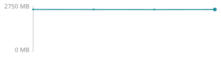 |
| `build/release/seconds` | 227 s | 262 s | -13% | 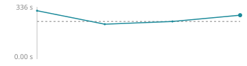 |

## Readings

| measure | last | baseline | change | runs |
| --- | ---: | ---: | ---: | --- |
| `read/atlas-0.70.0/cold/linked/library` | 4,143 | – | – |  |
| `read/atlas-0.70.0/cold/linked/program` | 2,986 | – | – |  |
| `read/atlas-0.70.0/cold/peak_rss` | 404 MB | – | – |  |
| `read/atlas-0.70.0/cold/phase/check` | 0.03 s | – | – |  |
| `read/atlas-0.70.0/cold/phase/flow` | 0.46 s | – | – |  |
| `read/atlas-0.70.0/cold/phase/page` | 0.13 s | – | – |  |
| `read/atlas-0.70.0/cold/phase/read` | 10.56 s | – | – |  |
| `read/atlas-0.70.0/cold/seconds` | 11.24 s | – | – | 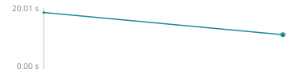 |
| `read/atlas-0.70.0/serve/first/seconds` | 11.48 s | – | – |  |
| `read/atlas-0.70.0/serve/peak_rss` | 368 MB | – | – |  |
| `read/atlas-0.70.0/serve/redraw/seconds` | 0.00 s | – | – |  |
| `read/atlas-0.70.0/serve/seconds` | 11.48 s | – | – | 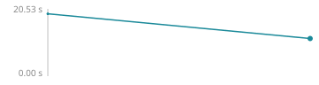 |
| `read/atlas-0.70.0/unasked/linked/library` | 4,143 | – | – |  |
| `read/atlas-0.70.0/unasked/linked/program` | 2,986 | – | – |  |
| `read/atlas-0.70.0/unasked/peak_rss` | 144 MB | – | – |  |
| `read/atlas-0.70.0/unasked/phase/check` | 0.03 s | – | – |  |
| `read/atlas-0.70.0/unasked/phase/flow` | 0.44 s | – | – |  |
| `read/atlas-0.70.0/unasked/phase/page` | 0.12 s | – | – |  |
| `read/atlas-0.70.0/unasked/phase/read` | 0.16 s | – | – |  |
| `read/atlas-0.70.0/unasked/seconds` | 0.78 s | – | – | 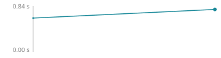 |
| `read/atlas-0.70.0/warm/linked/library` | 4,143 | – | – |  |
| `read/atlas-0.70.0/warm/linked/program` | 2,986 | – | – |  |
| `read/atlas-0.70.0/warm/peak_rss` | 144 MB | – | – |  |
| `read/atlas-0.70.0/warm/phase/check` | 0.03 s | – | – |  |
| `read/atlas-0.70.0/warm/phase/flow` | 0.45 s | – | – |  |
| `read/atlas-0.70.0/warm/phase/page` | 0.07 s | – | – |  |
| `read/atlas-0.70.0/warm/phase/read` | 0.16 s | – | – |  |
| `read/atlas-0.70.0/warm/seconds` | 0.73 s | – | – | 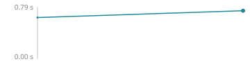 |
| `read/atlas/cold/linked/library` | 4,186 | – | – |  |
| `read/atlas/cold/linked/program` | 3,635 | – | – |  |
| `read/atlas/cold/peak_rss` | 448 MB | 409 MB | +10% | 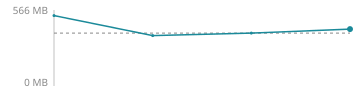 |
| `read/atlas/cold/phase/check` | 0.04 s | 0.04 s | +4% |  |
| `read/atlas/cold/phase/flow` | 0.85 s | 0.85 s | +0% |  |
| `read/atlas/cold/phase/page` | 0.10 s | 0.10 s | -1% |  |
| `read/atlas/cold/phase/read` | 12.75 s | 19.12 s | -33% |  |
| `read/atlas/cold/seconds` | 13.83 s | 19.97 s | -31% | 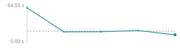 |
| `read/atlas/serve/first/seconds` | 13.55 s | – | – |  |
| `read/atlas/serve/peak_rss` | 423 MB | – | – | 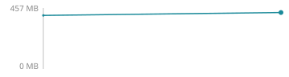 |
| `read/atlas/serve/redraw/seconds` | 0.00 s | – | – |  |
| `read/atlas/serve/seconds` | 13.55 s | – | – | 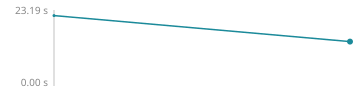 |
| `read/atlas/unasked/linked/library` | 4,186 | – | – |  |
| `read/atlas/unasked/linked/program` | 3,635 | – | – |  |
| `read/atlas/unasked/peak_rss` | 167 MB | – | – |  |
| `read/atlas/unasked/phase/check` | 0.04 s | – | – |  |
| `read/atlas/unasked/phase/flow` | 0.80 s | – | – |  |
| `read/atlas/unasked/phase/page` | 0.15 s | – | – |  |
| `read/atlas/unasked/phase/read` | 0.20 s | – | – |  |
| `read/atlas/unasked/seconds` | 1.22 s | – | – | 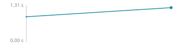 |
| `read/atlas/warm/linked/library` | 4,186 | – | – |  |
| `read/atlas/warm/linked/program` | 3,635 | – | – |  |
| `read/atlas/warm/peak_rss` | 167 MB | 149 MB | +12% | 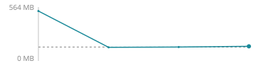 |
| `read/atlas/warm/phase/check` | 0.04 s | 0.04 s | +5% |  |
| `read/atlas/warm/phase/flow` | 0.85 s | 0.78 s | +9% |  |
| `read/atlas/warm/phase/page` | 0.15 s | 0.15 s | +2% |  |
| `read/atlas/warm/phase/read` | 0.19 s | 0.19 s | +5% |  |
| `read/atlas/warm/seconds` | 1.29 s | 1.17 s | +10% | 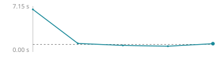 |
| `read/goad_toolkit-locked/cold/linked/library` | 12 | – | – |  |
| `read/goad_toolkit-locked/cold/linked/program` | 807 | – | – |  |
| `read/goad_toolkit-locked/cold/peak_rss` | 383 MB | – | – | 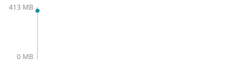 |
| `read/goad_toolkit-locked/cold/phase/check` | 0.00 s | – | – |  |
| `read/goad_toolkit-locked/cold/phase/flow` | 0.01 s | – | – |  |
| `read/goad_toolkit-locked/cold/phase/page` | 0.02 s | – | – |  |
| `read/goad_toolkit-locked/cold/phase/read` | 4.87 s | – | – |  |
| `read/goad_toolkit-locked/cold/seconds` | 4.94 s | – | – |  |
| `read/goad_toolkit-locked/serve/first/seconds` | 4.72 s | – | – |  |
| `read/goad_toolkit-locked/serve/peak_rss` | 383 MB | – | – |  |
| `read/goad_toolkit-locked/serve/redraw/seconds` | 0.00 s | – | – |  |
| `read/goad_toolkit-locked/serve/seconds` | 4.72 s | – | – |  |
| `read/goad_toolkit-locked/unasked/linked/library` | 12 | – | – |  |
| `read/goad_toolkit-locked/unasked/linked/program` | 807 | – | – |  |
| `read/goad_toolkit-locked/unasked/peak_rss` | 144 MB | – | – |  |
| `read/goad_toolkit-locked/unasked/phase/check` | 0.00 s | – | – |  |
| `read/goad_toolkit-locked/unasked/phase/flow` | 0.01 s | – | – |  |
| `read/goad_toolkit-locked/unasked/phase/page` | 0.02 s | – | – |  |
| `read/goad_toolkit-locked/unasked/phase/read` | 0.01 s | – | – |  |
| `read/goad_toolkit-locked/unasked/seconds` | 0.05 s | – | – | 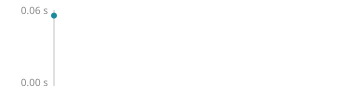 |
| `read/goad_toolkit-locked/warm/linked/library` | 12 | – | – |  |
| `read/goad_toolkit-locked/warm/linked/program` | 807 | – | – |  |
| `read/goad_toolkit-locked/warm/peak_rss` | 144 MB | – | – |  |
| `read/goad_toolkit-locked/warm/phase/check` | 0.00 s | – | – |  |
| `read/goad_toolkit-locked/warm/phase/flow` | 0.01 s | – | – |  |
| `read/goad_toolkit-locked/warm/phase/page` | 0.02 s | – | – |  |
| `read/goad_toolkit-locked/warm/phase/read` | 0.01 s | – | – |  |
| `read/goad_toolkit-locked/warm/seconds` | 0.06 s | – | – |  |
| `read/ordash/cold/linked/library` | 119 | – | – |  |
| `read/ordash/cold/linked/program` | 5 | – | – |  |
| `read/ordash/cold/peak_rss` suspect | 144 MB | 34 MB | +323% | 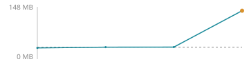 |
| `read/ordash/cold/phase/check` | 0.00 s | 0.00 s | -33% |  |
| `read/ordash/cold/phase/flow` | 0.00 s | 0.00 s | +50% |  |
| `read/ordash/cold/phase/page` | 0.01 s | 0.01 s | -24% |  |
| `read/ordash/cold/phase/read` | 0.10 s | 0.11 s | -7% |  |
| `read/ordash/cold/seconds` | 0.12 s | 0.13 s | -8% | 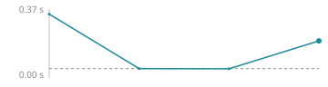 |
| `read/ordash/serve/first/seconds` | 0.12 s | – | – |  |
| `read/ordash/serve/peak_rss` | 144 MB | – | – |  |
| `read/ordash/serve/redraw/seconds` | 0.00 s | – | – |  |
| `read/ordash/serve/seconds` | 0.12 s | – | – | 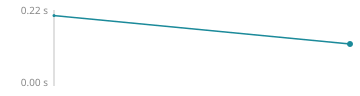 |
| `read/ordash/unasked/linked/library` | 119 | – | – |  |
| `read/ordash/unasked/linked/program` | 5 | – | – |  |
| `read/ordash/unasked/peak_rss` | 144 MB | – | – | 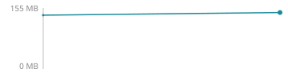 |
| `read/ordash/unasked/phase/check` | 0.00 s | – | – |  |
| `read/ordash/unasked/phase/flow` | 0.00 s | – | – |  |
| `read/ordash/unasked/phase/page` | 0.01 s | – | – |  |
| `read/ordash/unasked/phase/read` | 0.00 s | – | – |  |
| `read/ordash/unasked/seconds` | 0.01 s | – | – | 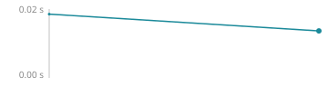 |
| `read/ordash/warm/linked/library` | 119 | – | – |  |
| `read/ordash/warm/linked/program` | 5 | – | – |  |
| `read/ordash/warm/peak_rss` suspect | 144 MB | 31 MB | +358% | 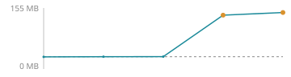 |
| `read/ordash/warm/phase/check` | 0.00 s | 0.00 s | -33% |  |
| `read/ordash/warm/phase/flow` | 0.00 s | 0.00 s | +50% |  |
| `read/ordash/warm/phase/page` | 0.01 s | 0.01 s | -24% |  |
| `read/ordash/warm/phase/read` | 0.00 s | 0.00 s | +5% |  |
| `read/ordash/warm/seconds` | 0.01 s | 0.02 s | -20% | 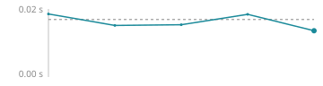 |
| `read/private-1/cold/linked/library` | 750 | – | – |  |
| `read/private-1/cold/linked/program` | 3,663 | – | – |  |
| `read/private-1/cold/peak_rss` | 739 MB | – | – |  |
| `read/private-1/cold/phase/check` | 0.02 s | – | – |  |
| `read/private-1/cold/phase/flow` | 0.10 s | – | – |  |
| `read/private-1/cold/phase/page` | 0.08 s | – | – |  |
| `read/private-1/cold/phase/read` | 15.19 s | – | – |  |
| `read/private-1/cold/seconds` | 15.45 s | – | – | 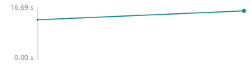 |
| `read/private-1/serve/first/seconds` | 16.57 s | – | – |  |
| `read/private-1/serve/peak_rss` | 735 MB | – | – |  |
| `read/private-1/serve/redraw/seconds` | 0.00 s | – | – |  |
| `read/private-1/serve/seconds` | 16.57 s | – | – | 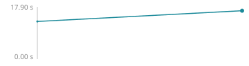 |
| `read/private-1/unasked/linked/library` | 750 | – | – |  |
| `read/private-1/unasked/linked/program` | 3,663 | – | – |  |
| `read/private-1/unasked/peak_rss` | 144 MB | – | – |  |
| `read/private-1/unasked/phase/check` | 0.02 s | – | – |  |
| `read/private-1/unasked/phase/flow` | 0.08 s | – | – |  |
| `read/private-1/unasked/phase/page` | 0.09 s | – | – |  |
| `read/private-1/unasked/phase/read` | 0.30 s | – | – |  |
| `read/private-1/unasked/seconds` | 0.51 s | – | – | 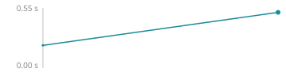 |
| `read/private-1/warm/linked/library` | 750 | – | – |  |
| `read/private-1/warm/linked/program` | 3,663 | – | – |  |
| `read/private-1/warm/peak_rss` | 144 MB | – | – |  |
| `read/private-1/warm/phase/check` | 0.02 s | – | – |  |
| `read/private-1/warm/phase/flow` | 0.09 s | – | – |  |
| `read/private-1/warm/phase/page` | 0.05 s | – | – |  |
| `read/private-1/warm/phase/read` | 0.30 s | – | – |  |
| `read/private-1/warm/seconds` | 0.48 s | – | – | 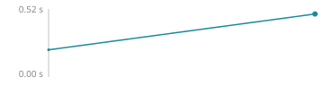 |
| `read/vectormesh-locked/cold/linked/library` | 11 | – | – |  |
| `read/vectormesh-locked/cold/linked/program` | 765 | – | – |  |
| `read/vectormesh-locked/cold/peak_rss` | 676 MB | – | – |  |
| `read/vectormesh-locked/cold/phase/check` | 0.00 s | – | – |  |
| `read/vectormesh-locked/cold/phase/flow` | 0.01 s | – | – |  |
| `read/vectormesh-locked/cold/phase/page` | 0.01 s | – | – |  |
| `read/vectormesh-locked/cold/phase/read` | 4.08 s | – | – |  |
| `read/vectormesh-locked/cold/seconds` | 4.17 s | – | – | 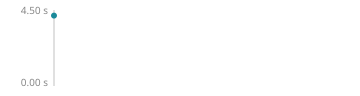 |
| `read/vectormesh-locked/serve/first/seconds` | 4.27 s | – | – |  |
| `read/vectormesh-locked/serve/peak_rss` | 676 MB | – | – |  |
| `read/vectormesh-locked/serve/redraw/seconds` | 0.00 s | – | – |  |
| `read/vectormesh-locked/serve/seconds` | 4.27 s | – | – | 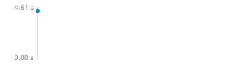 |
| `read/vectormesh-locked/unasked/linked/library` | 11 | – | – |  |
| `read/vectormesh-locked/unasked/linked/program` | 765 | – | – |  |
| `read/vectormesh-locked/unasked/peak_rss` | 144 MB | – | – |  |
| `read/vectormesh-locked/unasked/phase/check` | 0.00 s | – | – |  |
| `read/vectormesh-locked/unasked/phase/flow` | 0.01 s | – | – |  |
| `read/vectormesh-locked/unasked/phase/page` | 0.02 s | – | – |  |
| `read/vectormesh-locked/unasked/phase/read` | 0.01 s | – | – |  |
| `read/vectormesh-locked/unasked/seconds` | 0.06 s | – | – |  |
| `read/vectormesh-locked/warm/linked/library` | 11 | – | – |  |
| `read/vectormesh-locked/warm/linked/program` | 765 | – | – |  |
| `read/vectormesh-locked/warm/peak_rss` | 144 MB | – | – |  |
| `read/vectormesh-locked/warm/phase/check` | 0.00 s | – | – |  |
| `read/vectormesh-locked/warm/phase/flow` | 0.01 s | – | – |  |
| `read/vectormesh-locked/warm/phase/page` | 0.02 s | – | – |  |
| `read/vectormesh-locked/warm/phase/read` | 0.01 s | – | – |  |
| `read/vectormesh-locked/warm/seconds` | 0.06 s | – | – |  |

## Tests

| measure | last | baseline | change | runs |
| --- | ---: | ---: | ---: | --- |
| `tests/atlas-code/atlas-code/seconds` | 0.18 s | 0.53 s | -66% |  |
| `tests/atlas-code/exit/seconds` | 0.11 s | 0.10 s | +13% |  |
| `tests/atlas-code/help/seconds` | 0.01 s | 0.01 s | +6% |  |
| `tests/atlas-code/history/seconds` | 0.24 s | 0.27 s | -12% |  |
| `tests/atlas-code/mcp/seconds` | 0.48 s | 0.58 s | -17% |  |
| `tests/atlas-code/serve/seconds` | 12.05 s | 12.26 s | -2% |  |
| `tests/atlas-code/view/seconds` | 0.21 s | 0.21 s | +1% |  |
| `tests/atlas-engine/arrows/seconds` | 0.07 s | 0.10 s | -29% |  |
| `tests/atlas-engine/aside/seconds` | 0.47 s | 0.42 s | +12% |  |
| `tests/atlas-engine/cache/seconds` | 0.55 s | 0.42 s | +31% |  |
| `tests/atlas-engine/changes/seconds` | 0.38 s | 0.23 s | +63% |  |
| `tests/atlas-engine/composition/seconds` | 0.71 s | 0.69 s | +3% |  |
| `tests/atlas-engine/diff/seconds` | 1.21 s | 1.12 s | +8% |  |
| `tests/atlas-engine/environment/seconds` | 0.04 s | 0.05 s | -24% |  |
| `tests/atlas-engine/laws/seconds` | 0.03 s | 0.03 s | -4% |  |
| `tests/atlas-engine/lib/seconds` | 0.56 s | 0.33 s | +69% |  |
| `tests/atlas-engine/libraries/seconds` | 0.32 s | 0.32 s | -1% |  |
| `tests/atlas-engine/library_depth/seconds` | 0.33 s | 0.39 s | -15% |  |
| `tests/atlas-engine/merge/seconds` | 0.03 s | 0.03 s | -9% |  |
| `tests/atlas-engine/named/seconds` | 0.77 s | 0.81 s | -4% |  |
| `tests/atlas-engine/one_name/seconds` | 0.63 s | – | – |  |
| `tests/atlas-engine/pairs/seconds` suspect | 5.49 s | 0.53 s | +928% | 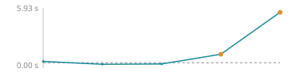 |
| `tests/atlas-engine/pairs_aliases/seconds` | 0.57 s | 0.57 s | -0% |  |
| `tests/atlas-engine/pairs_body/seconds` | 0.64 s | 0.67 s | -4% |  |
| `tests/atlas-engine/pairs_figures/seconds` | 13.63 s | 9.46 s | +44% |  |
| `tests/atlas-engine/pairs_loops/seconds` | 0.19 s | 0.17 s | +12% |  |
| `tests/atlas-engine/pairs_pipeline/seconds` suspect | 1.21 s | 0.27 s | +342% | 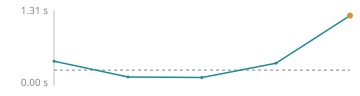 |
| `tests/atlas-engine/pairs_python/seconds` suspect | 9.82 s | 4.97 s | +98% | 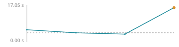 |
| `tests/atlas-engine/pairs_readback/seconds` | 0.27 s | 0.34 s | -21% |  |
| `tests/atlas-engine/pairs_rust/seconds` | 3.66 s | 1.95 s | +88% |  |
| `tests/atlas-engine/pairs_storage/seconds` | 0.37 s | 0.33 s | +12% |  |
| `tests/atlas-engine/pairs_typescript/seconds` suspect | 3.39 s | 1.63 s | +108% | 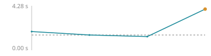 |
| `tests/atlas-engine/parse/seconds` | 24.13 s | 28.79 s | -16% |  |
| `tests/atlas-engine/parts/seconds` | 0.90 s | 1.16 s | -22% |  |
| `tests/atlas-engine/plans/seconds` suspect | 602 s | 114 s | +427% | 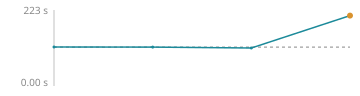 |
| `tests/atlas-engine/principles/seconds` | 0.68 s | 0.75 s | -10% |  |
| `tests/atlas-engine/prophetize/seconds` | 0.01 s | 0.01 s | +47% |  |
| `tests/atlas-engine/python_reader/seconds` | 0.27 s | 0.19 s | +47% |  |
| `tests/atlas-engine/ran_before/seconds` | 1.29 s | – | – |  |
| `tests/atlas-engine/readers/seconds` | 0.16 s | 0.16 s | -2% |  |
| `tests/atlas-engine/reading_order/seconds` | 0.26 s | – | – |  |
| `tests/atlas-engine/remote/seconds` | 0.12 s | 0.14 s | -9% |  |
| `tests/atlas-engine/resolution/seconds` | 0.40 s | 0.40 s | -1% |  |
| `tests/atlas-engine/review/seconds` | 20.56 s | 25.28 s | -19% |  |
| `tests/atlas-engine/route_text/seconds` | 0.82 s | – | – |  |
| `tests/atlas-engine/rust_facts/seconds` | 0.01 s | 0.05 s | -71% |  |
| `tests/atlas-engine/rust_reader/seconds` | 0.05 s | 0.05 s | +6% |  |
| `tests/atlas-engine/sample/seconds` | 0.00 s | 0.02 s | -87% |  |
| `tests/atlas-engine/story/seconds` | 0.04 s | 0.02 s | +151% |  |
| `tests/atlas-engine/typescript/seconds` | 0.35 s | 0.18 s | +92% |  |
| `tests/atlas-engine/versions/seconds` | 0.12 s | – | – |  |
| `tests/atlas-engine/wording/seconds` | 0.92 s | 0.80 s | +14% |  |
| `tests/atlas-engine/workspace_index/seconds` | 0.30 s | 0.20 s | +55% |  |
| `tests/total/seconds` suspect | 712 s | 241 s | +195% | 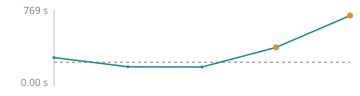 |
