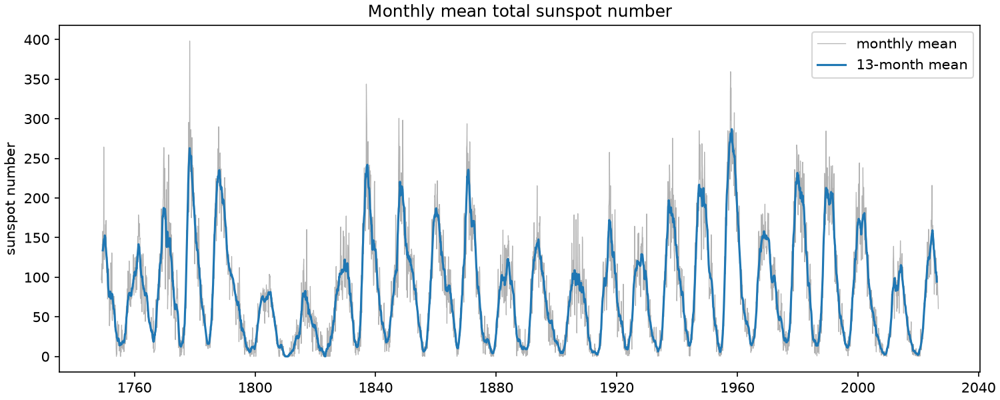
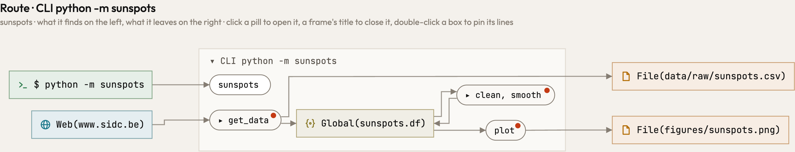
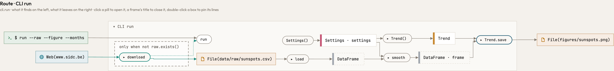
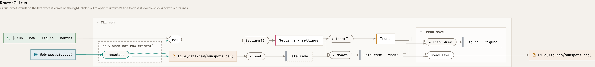
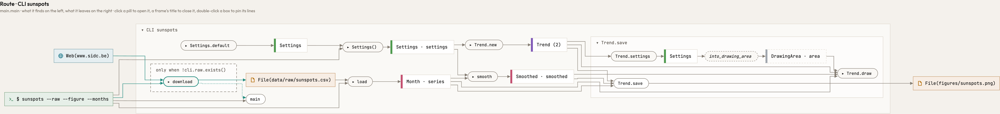

<p align="center">
  
</p>

<h1 align="center">Atlas</h1>

<p align="center">
  <b>What a program is, beneath the language it is written in.</b>
</p>

<p align="center">
  <a href="https://raoulg.github.io/atlas/"><b>See it</b></a> ·
  <a href="#install">Install</a> ·
  <a href="docs/llms.txt">For agents</a>
</p>

<p align="center">
  <a href="https://claude.com/claude-code"></a>
  <a href="LICENSE"></a>
  
  
</p>

Two programs can show you the same screen. One is sloppy code with lots of shortcuts and
inconsistent structure. The other is an elegant orchestration of logic. Atlas shows which is which.

## The same program. The same figure.

Fetch sunspot counts from the web, keep the CSV, clean it, smooth it, draw a figure. Written twice in
Python: once as a sloppy script, once typed and elegant. Atlas draws what each one does.

<p align="center">
  
  <br><sub>What both make: the monthly mean sunspot number since 1749 (SILSO, Royal Observatory of Belgium), smoothed over 13 months.</sub>
</p>

<h3 align="center">A sloppy script</h3>
<p align="center">
  <a href="https://raoulg.github.io/atlas/showcase/python-sloppy.html"></a>
</p>

<h3 align="center">Typed and elegant</h3>
<p align="center">
  <a href="https://raoulg.github.io/atlas/showcase/python-clean.html"></a>
</p>

Both reach the same places: the web, the raw CSV, the figure. Inside they part. In the sloppy script
every step reads and changes one global, `Global(sunspots.df)`; nothing is handed from step to step,
and `get_data` downloads on every run and reads back the CSV it has just written, so the file is
only what it leaves behind. In the typed one `download` runs only when no CSV is kept, in a frame
that says so (`only when not raw.exists()`), and `load` reads what is there, so the file stands
between the two; a `DataFrame` goes from `load` to `smooth` to `Trend.save`, and the command names
every file. A red dot is a question Atlas asks the author: why do `get_data` and `plot` pick their
own files, and what do the four functions give back? Click a picture to open it in Atlas.

## Ported to Rust. A picture alike.

Code gets rewritten in another language: for speed, for one binary to ship, for a team, and more
and more often by an agent. Tests tell you the port gives the same figure. They don't tell you
whether the design survived: the same steps, the same values handed between them, the same places.
Atlas draws every language in the same terms, so the original and the port can lie side by side:
the same shape where the design survived, and differences where it did not, or where the language
works otherwise.

<h3 align="center">Python, typed</h3>
<p align="center">
  <a href="https://raoulg.github.io/atlas/showcase/python-clean-save.html"></a>
</p>

<h3 align="center">Rust, ported</h3>
<p align="center">
  <a href="https://raoulg.github.io/atlas/showcase/rust-clean.html"></a>
</p>

The shape is the same: the web, the raw CSV and the figure, and between them `download`, `load`,
`smooth` and `Trend.save`, open here. The differences are the interesting part. A step gone or a
place moved would be drift, and Atlas would show where. Here it is the language speaking:

| | Python | Rust |
|---|---|---|
| **The values** | one pandas `DataFrame`, in and out of `smooth` | the program's own records: `Month · series` in, `Smoothed · smoothed` out |
| **The figure** | `Trend.draw` gives a `Figure`, and `save` writes it | `save` opens a `DrawingArea` on the file first, and `draw` draws straight into it |
| **Defaults** | in the signature | a function, `Settings.default`: Rust has no default arguments |

## The mathematics of your code

Mathematics is a language that allows you to make things consistent. Best practices in coding are
consistent, so it makes sense to view your computer code through a mathematical perspective.
Because we can turn the mathematics of the code into a visual, you can literally see the
consistency of your code, if you followed best practices. This is independent of the language you
use: every program is drawn by the same mathematical rules.

**What is inside:**

*[Category theory](https://pttrn.io/#content/category-theory)*

- **A category of types.** Types are objects, functions are arrows, call order is composition. A
  route is a composite from an entry point to a place.
- **Sum types are coproducts.** Taken apart where they arise.
- **Lawful lenses.** A class that writes a place and reads it back is a lens on that place. Atlas
  asks the put-get law at the level of types: what goes in as a `Graph` comes back as a `Graph`.

*Topology*

- **Zooming out glues, a filter is a fiber.** Zooming out glues each family of types (by base
  class, by composition, by module) into one point: a quotient. Keeping to one route is the fiber
  over it, the part that lies above one point. Gluing and taking a fiber don't commute, so the
  order of a view is meaning.
- **Fine and coarse.** A zoom level divides the nodes into boxes, and each such division is a
  topology on them. Zooming in and out moves between finer and coarser ones, so the picture stays
  the same picture.

*Type theory*

- **Effects in the type.** A function's domain is its parameters plus what it reads; its codomain
  is what it returns plus what it writes, sends or runs, as in a type-and-effect system. Files,
  tables and URLs are objects like any other.
- **Subtypes keep their promise.** An override does what its base says (behavioural subtyping,
  Liskov).

*Graph theory*

- **A step and its reach.** A function's own arrow and everything it reaches are different
  quantities, never merged.

Every notion, with where it lives in Atlas, is in [the mathematics](docs/reference/mathematics.md).
The structure is laid out in [the design](docs/reference/design.md); what Atlas checks against it
is in [the ten principles](docs/reference/principles.md).

## Install

**macOS and Linux:**

```bash
curl -fsSL https://raw.githubusercontent.com/raoulg/atlas/main/install.sh | sh
```

**Windows**, in PowerShell:

```powershell
irm https://raw.githubusercontent.com/raoulg/atlas/main/install.ps1 | iex
```

**From source**, with a [Rust toolchain](https://rustup.rs):

```bash
cargo install --locked --git https://github.com/raoulg/atlas atlas
```

## Use

```bash
atlas serve     # the picture of the repository you are in, to work in with your agent
atlas view      # the same picture as one HTML file, to keep or send
atlas check     # where the code and ten design principles disagree
atlas changes   # what your edit did to the routes
atlas mcp       # the picture for your coding agent
```

`atlas serve` is the page to work in. It follows the code: when a file changes, the picture is
drawn anew in the view you have. It shares what you have open with your agent, which can
also point you to a box, and show you a change it proposes beside the code as it is, before it
makes it. Alt-click a box or a line to leave it a note; the agent resolves it and
tells you how, and puts what must last in an issue that links back to the box. The history of commits is a click away, and **export** keeps the picture as a file.
`atlas view` writes that file straight from the command line, for a script or an agent.

**Your agent** gets Atlas through `atlas mcp`. Register it once, for every project:

```bash
claude mcp add --scope user atlas -- atlas mcp
codex mcp add atlas -- "$(command -v atlas)" mcp
```

Claude Code's `--scope user` makes it available in every project. Codex keeps its servers in one
configuration for all projects and starts them without your shell's `PATH`, so it is given the
binary's full path, which `command -v atlas` prints. From then on `atlas serve` in any repository
is all it takes: the agent's `atlas mcp` works on the repository the agent runs in, and shares the
page with you.

## More

- [**See it**](https://raoulg.github.io/atlas/): the same pictures on one page, to click through.
- [**For agents**](docs/llms.txt): what Atlas is for and how an agent should use it, then the design,
  the principles and the guide, written to be read in one go.

Alpha: what Atlas reads and draws changes from one minor version to the next. Built by Raoul Grouls
with [Claude Code](https://claude.com/claude-code). [CC BY-NC-SA 4.0](LICENSE).
