# Atlas's performance, measured every night on `next`

Written by `tools/perf.py` from `history.jsonl`, one line per run; how it measures and judges is in
`docs/reference/performance.md`. An amber dot is a run past its baseline (dashed), measured again on its
runner against the last commit within it; a red dot is one that measurement reproduced.

Last run: 2026-10-31T10:42Z, `842b999`, Intel(R) Xeon(R) 6973P-C, 4 cores. Runs kept: 3.

## The release build

| measure | last | baseline | change | runs |
| --- | ---: | ---: | ---: | --- |
| `build/release/peak_rss` | 2541 MB | – | – |  |
| `build/release/seconds` | 242 s | – | – |  |

## Readings

| measure | last | baseline | change | runs |
| --- | ---: | ---: | ---: | --- |
| `read/atlas/cold/peak_rss` | 394 MB | – | – |  |
| `read/atlas/cold/phase/check` | 0.04 s | – | – |  |
| `read/atlas/cold/phase/flow` | 0.76 s | – | – |  |
| `read/atlas/cold/phase/page` | 0.09 s | – | – |  |
| `read/atlas/cold/phase/read` | 18.04 s | – | – |  |
| `read/atlas/cold/seconds` | 18.99 s | – | – | 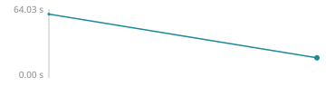 |
| `read/atlas/warm/peak_rss` | 145 MB | – | – |  |
| `read/atlas/warm/phase/check` | 0.04 s | – | – |  |
| `read/atlas/warm/phase/flow` | 0.67 s | – | – |  |
| `read/atlas/warm/phase/page` | 0.12 s | – | – |  |
| `read/atlas/warm/phase/read` | 0.16 s | – | – |  |
| `read/atlas/warm/seconds` | 1.02 s | – | – | 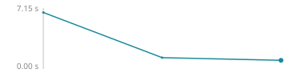 |
| `read/goad_toolkit/cold/peak_rss` | 78 MB | – | – |  |
| `read/goad_toolkit/cold/phase/check` | 0.00 s | – | – |  |
| `read/goad_toolkit/cold/phase/flow` | 0.01 s | – | – |  |
| `read/goad_toolkit/cold/phase/page` | 0.03 s | – | – |  |
| `read/goad_toolkit/cold/phase/read` | 0.64 s | – | – |  |
| `read/goad_toolkit/cold/seconds` | 0.68 s | – | – | 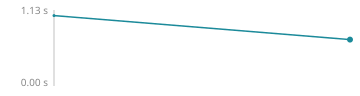 |
| `read/goad_toolkit/warm/peak_rss` | 37 MB | – | – | 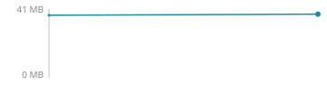 |
| `read/goad_toolkit/warm/phase/check` | 0.00 s | – | – |  |
| `read/goad_toolkit/warm/phase/flow` | 0.01 s | – | – |  |
| `read/goad_toolkit/warm/phase/page` | 0.02 s | – | – |  |
| `read/goad_toolkit/warm/phase/read` | 0.01 s | – | – |  |
| `read/goad_toolkit/warm/seconds` | 0.04 s | – | – | 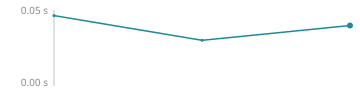 |
| `read/ordash/cold/peak_rss` | 34 MB | – | – |  |
| `read/ordash/cold/phase/check` | 0.00 s | – | – |  |
| `read/ordash/cold/phase/flow` | 0.00 s | – | – |  |
| `read/ordash/cold/phase/page` | 0.01 s | – | – |  |
| `read/ordash/cold/phase/read` | 0.04 s | – | – |  |
| `read/ordash/cold/seconds` | 0.05 s | – | – | 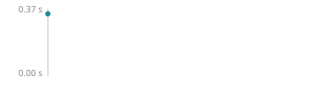 |
| `read/ordash/warm/peak_rss` | 31 MB | – | – |  |
| `read/ordash/warm/phase/check` | 0.00 s | – | – |  |
| `read/ordash/warm/phase/flow` | 0.00 s | – | – |  |
| `read/ordash/warm/phase/page` | 0.01 s | – | – |  |
| `read/ordash/warm/phase/read` | 0.00 s | – | – |  |
| `read/ordash/warm/seconds` | 0.01 s | – | – |  |
| `read/pluim/cold/peak_rss` | 73 MB | – | – | 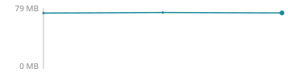 |
| `read/pluim/cold/phase/check` | 0.00 s | – | – |  |
| `read/pluim/cold/phase/flow` | 0.00 s | – | – |  |
| `read/pluim/cold/phase/page` | 0.02 s | – | – |  |
| `read/pluim/cold/phase/read` | 0.75 s | – | – |  |
| `read/pluim/cold/seconds` | 0.78 s | – | – | 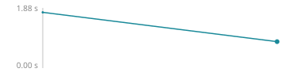 |
| `read/pluim/warm/peak_rss` | 39 MB | – | – | 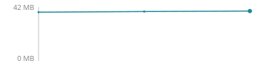 |
| `read/pluim/warm/phase/check` | 0.00 s | – | – |  |
| `read/pluim/warm/phase/flow` | 0.00 s | – | – |  |
| `read/pluim/warm/phase/page` | 0.02 s | – | – |  |
| `read/pluim/warm/phase/read` | 0.01 s | – | – |  |
| `read/pluim/warm/seconds` | 0.03 s | – | – | 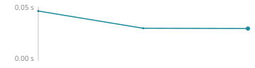 |
| `read/vectormesh/cold/peak_rss` | 93 MB | – | – |  |
| `read/vectormesh/cold/phase/check` | 0.00 s | – | – |  |
| `read/vectormesh/cold/phase/flow` | 0.01 s | – | – |  |
| `read/vectormesh/cold/phase/page` | 0.02 s | – | – |  |
| `read/vectormesh/cold/phase/read` | 0.90 s | – | – |  |
| `read/vectormesh/cold/seconds` | 0.94 s | – | – | 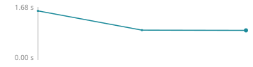 |
| `read/vectormesh/warm/peak_rss` | 40 MB | – | – |  |
| `read/vectormesh/warm/phase/check` | 0.00 s | – | – |  |
| `read/vectormesh/warm/phase/flow` | 0.01 s | – | – |  |
| `read/vectormesh/warm/phase/page` | 0.02 s | – | – |  |
| `read/vectormesh/warm/phase/read` | 0.01 s | – | – |  |
| `read/vectormesh/warm/seconds` | 0.05 s | – | – | 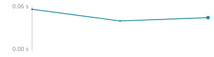 |

## Tests

| measure | last | baseline | change | runs |
| --- | ---: | ---: | ---: | --- |
| `tests/atlas-code/atlas-code/seconds` | 6.61 s | – | – |  |
| `tests/atlas-code/exit/seconds` | 0.06 s | – | – |  |
| `tests/atlas-code/help/seconds` | 0.01 s | – | – |  |
| `tests/atlas-code/history/seconds` | 0.23 s | – | – |  |
| `tests/atlas-code/mcp/seconds` | 0.42 s | – | – |  |
| `tests/atlas-code/serve/seconds` | 12.23 s | – | – |  |
| `tests/atlas-code/view/seconds` | 0.17 s | – | – |  |
| `tests/atlas-engine/arrows/seconds` | 0.08 s | – | – |  |
| `tests/atlas-engine/aside/seconds` | 0.26 s | – | – |  |
| `tests/atlas-engine/cache/seconds` | 0.29 s | – | – |  |
| `tests/atlas-engine/changes/seconds` | 0.24 s | – | – |  |
| `tests/atlas-engine/composition/seconds` | 0.65 s | – | – |  |
| `tests/atlas-engine/diff/seconds` | 0.84 s | – | – |  |
| `tests/atlas-engine/environment/seconds` | 0.04 s | – | – |  |
| `tests/atlas-engine/laws/seconds` | 0.02 s | – | – |  |
| `tests/atlas-engine/lib/seconds` | 0.32 s | – | – |  |
| `tests/atlas-engine/libraries/seconds` | 0.29 s | – | – |  |
| `tests/atlas-engine/library_depth/seconds` | 0.31 s | – | – |  |
| `tests/atlas-engine/merge/seconds` | 0.03 s | – | – |  |
| `tests/atlas-engine/named/seconds` | 0.61 s | – | – |  |
| `tests/atlas-engine/pairs/seconds` | 0.41 s | – | – |  |
| `tests/atlas-engine/pairs_aliases/seconds` | 0.55 s | – | – |  |
| `tests/atlas-engine/pairs_body/seconds` | 0.54 s | – | – |  |
| `tests/atlas-engine/pairs_figures/seconds` | 7.67 s | – | – |  |
| `tests/atlas-engine/pairs_loops/seconds` | 0.09 s | – | – |  |
| `tests/atlas-engine/pairs_pipeline/seconds` | 0.15 s | – | – |  |
| `tests/atlas-engine/pairs_python/seconds` | 3.65 s | – | – |  |
| `tests/atlas-engine/pairs_readback/seconds` | 0.23 s | – | – |  |
| `tests/atlas-engine/pairs_rust/seconds` | 1.38 s | – | – |  |
| `tests/atlas-engine/pairs_storage/seconds` | 0.15 s | – | – |  |
| `tests/atlas-engine/pairs_typescript/seconds` | 1.31 s | – | – |  |
| `tests/atlas-engine/parse/seconds` | 19.41 s | – | – |  |
| `tests/atlas-engine/parts/seconds` | 0.80 s | – | – |  |
| `tests/atlas-engine/plans/seconds` | 112 s | – | – |  |
| `tests/atlas-engine/principles/seconds` | 0.60 s | – | – |  |
| `tests/atlas-engine/prophetize/seconds` | 0.01 s | – | – |  |
| `tests/atlas-engine/python_reader/seconds` | 0.17 s | – | – |  |
| `tests/atlas-engine/readers/seconds` | 0.14 s | – | – |  |
| `tests/atlas-engine/remote/seconds` | 0.15 s | – | – |  |
| `tests/atlas-engine/resolution/seconds` | 0.26 s | – | – |  |
| `tests/atlas-engine/review/seconds` | 18.30 s | – | – |  |
| `tests/atlas-engine/rust_facts/seconds` | 0.05 s | – | – |  |
| `tests/atlas-engine/rust_reader/seconds` | 0.05 s | – | – |  |
| `tests/atlas-engine/sample/seconds` | 0.02 s | – | – |  |
| `tests/atlas-engine/story/seconds` | 0.01 s | – | – |  |
| `tests/atlas-engine/typescript/seconds` | 0.10 s | – | – |  |
| `tests/atlas-engine/wording/seconds` | 0.65 s | – | – |  |
| `tests/atlas-engine/workspace_index/seconds` | 0.21 s | – | – |  |
| `tests/total/seconds` | 192 s | – | – |  |
