# Atlas's performance, measured every night on `next`

Written by `tools/perf.py` from `history.jsonl`, one line per run; how it measures and judges is in
`docs/reference/performance.md`. An amber dot is a run past its baseline (dashed), measured again on its
runner against the last commit within it; a red dot is one that measurement reproduced.

Last run: 2026-11-06T12:46Z, `d90c452`, AMD EPYC 9V74 80-Core Processor, 4 cores. Runs kept: 4.

## What is read

Each subject by its card, as the last run read it: the files of its own modules and their lines that are
not blank, its modules and functions, and of the graph with the libraries' part in it, the nodes, the
edges and the library bodies linked. The programs of `tools/corpus.txt` are read at a fixed revision;
`atlas` is Atlas at the commit measured.

| subject | revision | card |
| --- | --- | --- |
| `atlas` | `d90c452`, the commit measured | Rust · 123 files · 71,338 lines · 123 modules · 3,472 functions · 4,299 nodes · 18,203 edges · 3,743 library bodies |
| `atlas-0.70.0` | `4ebbbae` | Rust · 117 files · 60,291 lines · 117 modules · 2,986 functions · 3,753 nodes · 15,637 edges · 3,700 library bodies |
| `goad_toolkit` | `929d37c` | Python · 12 files · 4,382 lines · 12 modules · 169 functions · 276 nodes · 772 edges · 0 library bodies |
| `ordash` | `1b49422` | Rust · 1 file · 317 lines · 1 module · 5 functions · 19 nodes · 35 edges · 119 library bodies |
| `private-1` | `0d49bb1` | Python + TypeScript · 279 files · 44,696 lines · 297 modules · 1,385 functions · 2,030 nodes · 5,873 edges · 0 library bodies |
| `vectormesh` | `201a850` | Python · 35 files · 11,096 lines · 35 modules · 238 functions · 391 nodes · 966 edges · 0 library bodies |

## The release build

| measure | last | baseline | change | runs |
| --- | ---: | ---: | ---: | --- |
| `build/release/peak_rss` | 2545 MB | 2543 MB | +0% |  |
| `build/release/seconds` | 282 s | 242 s | +17% |  |

## Readings

| measure | last | baseline | change | runs |
| --- | ---: | ---: | ---: | --- |
| `read/atlas-0.70.0/cold/linked/library` | 3,700 | – | – |  |
| `read/atlas-0.70.0/cold/linked/program` | 2,986 | – | – |  |
| `read/atlas-0.70.0/cold/peak_rss` | 392 MB | – | – |  |
| `read/atlas-0.70.0/cold/phase/check` | 0.05 s | – | – |  |
| `read/atlas-0.70.0/cold/phase/flow` | 0.26 s | – | – |  |
| `read/atlas-0.70.0/cold/phase/page` | 0.10 s | – | – |  |
| `read/atlas-0.70.0/cold/phase/read` | 18.04 s | – | – |  |
| `read/atlas-0.70.0/cold/seconds` | 18.53 s | – | – |  |
| `read/atlas-0.70.0/serve/first/seconds` | 19.01 s | – | – |  |
| `read/atlas-0.70.0/serve/peak_rss` | 363 MB | – | – |  |
| `read/atlas-0.70.0/serve/redraw/seconds` | 0.00 s | – | – |  |
| `read/atlas-0.70.0/serve/seconds` | 19.01 s | – | – |  |
| `read/atlas-0.70.0/unasked/linked/library` | 3,700 | – | – |  |
| `read/atlas-0.70.0/unasked/linked/program` | 2,986 | – | – |  |
| `read/atlas-0.70.0/unasked/peak_rss` | 137 MB | – | – |  |
| `read/atlas-0.70.0/unasked/phase/check` | 0.04 s | – | – |  |
| `read/atlas-0.70.0/unasked/phase/flow` | 0.22 s | – | – |  |
| `read/atlas-0.70.0/unasked/phase/page` | 0.09 s | – | – |  |
| `read/atlas-0.70.0/unasked/phase/read` | 0.23 s | – | – |  |
| `read/atlas-0.70.0/unasked/seconds` | 0.62 s | – | – |  |
| `read/atlas-0.70.0/warm/linked/library` | 3,700 | – | – |  |
| `read/atlas-0.70.0/warm/linked/program` | 2,986 | – | – |  |
| `read/atlas-0.70.0/warm/peak_rss` | 137 MB | – | – |  |
| `read/atlas-0.70.0/warm/phase/check` | 0.04 s | – | – |  |
| `read/atlas-0.70.0/warm/phase/flow` | 0.22 s | – | – |  |
| `read/atlas-0.70.0/warm/phase/page` | 0.10 s | – | – |  |
| `read/atlas-0.70.0/warm/phase/read` | 0.23 s | – | – |  |
| `read/atlas-0.70.0/warm/seconds` | 0.63 s | – | – |  |
| `read/atlas/cold/linked/library` | 3,743 | – | – |  |
| `read/atlas/cold/linked/program` | 3,472 | – | – |  |
| `read/atlas/cold/peak_rss` | 424 MB | 394 MB | +7% |  |
| `read/atlas/cold/phase/check` | 0.07 s | 0.04 s | +68% |  |
| `read/atlas/cold/phase/flow` | 0.48 s | 0.93 s | -49% |  |
| `read/atlas/cold/phase/page` | 0.12 s | 0.09 s | +24% |  |
| `read/atlas/cold/phase/read` | 20.20 s | 18.04 s | +12% |  |
| `read/atlas/cold/seconds` | 20.94 s | 18.99 s | +10% |  |
| `read/atlas/serve/first/seconds` | 21.47 s | – | – |  |
| `read/atlas/serve/peak_rss` | 401 MB | – | – |  |
| `read/atlas/serve/redraw/seconds` | 0.00 s | – | – |  |
| `read/atlas/serve/seconds` | 21.47 s | – | – |  |
| `read/atlas/unasked/linked/library` | 3,743 | – | – |  |
| `read/atlas/unasked/linked/program` | 3,472 | – | – |  |
| `read/atlas/unasked/peak_rss` | 153 MB | – | – |  |
| `read/atlas/unasked/phase/check` | 0.06 s | – | – |  |
| `read/atlas/unasked/phase/flow` | 0.42 s | – | – |  |
| `read/atlas/unasked/phase/page` | 0.11 s | – | – |  |
| `read/atlas/unasked/phase/read` | 0.27 s | – | – |  |
| `read/atlas/unasked/seconds` | 0.89 s | – | – |  |
| `read/atlas/warm/linked/library` | 3,743 | – | – |  |
| `read/atlas/warm/linked/program` | 3,472 | – | – |  |
| `read/atlas/warm/peak_rss` | 153 MB | 145 MB | +5% |  |
| `read/atlas/warm/phase/check` | 0.06 s | 0.04 s | +78% |  |
| `read/atlas/warm/phase/flow` | 0.42 s | 0.89 s | -53% |  |
| `read/atlas/warm/phase/page` | 0.11 s | 0.18 s | -40% |  |
| `read/atlas/warm/phase/read` | 0.27 s | 0.18 s | +48% |  |
| `read/atlas/warm/seconds` | 0.90 s | 1.32 s | -32% |  |
| `read/goad_toolkit/cold/linked/library` | 0 | – | – |  |
| `read/goad_toolkit/cold/linked/program` | 181 | – | – |  |
| `read/goad_toolkit/cold/peak_rss` suspect | 137 MB | 78 MB | +75% | 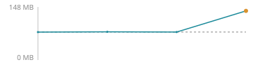 |
| `read/goad_toolkit/cold/phase/check` | 0.00 s | 0.00 s | +33% |  |
| `read/goad_toolkit/cold/phase/flow` | 0.01 s | 0.01 s | +22% |  |
| `read/goad_toolkit/cold/phase/page` | 0.02 s | 0.03 s | -36% |  |
| `read/goad_toolkit/cold/phase/read` suspect | 1.21 s | 0.65 s | +87% | 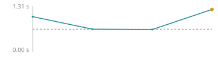 |
| `read/goad_toolkit/cold/seconds` suspect | 1.24 s | 0.69 s | +80% | 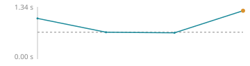 |
| `read/goad_toolkit/serve/first/seconds` | 1.26 s | – | – |  |
| `read/goad_toolkit/serve/peak_rss` | 137 MB | – | – |  |
| `read/goad_toolkit/serve/redraw/seconds` | 0.00 s | – | – |  |
| `read/goad_toolkit/serve/seconds` | 1.26 s | – | – | 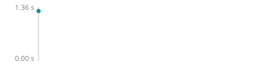 |
| `read/goad_toolkit/unasked/linked/library` | 0 | – | – |  |
| `read/goad_toolkit/unasked/linked/program` | 181 | – | – |  |
| `read/goad_toolkit/unasked/peak_rss` | 137 MB | – | – |  |
| `read/goad_toolkit/unasked/phase/check` | 0.00 s | – | – |  |
| `read/goad_toolkit/unasked/phase/flow` | 0.01 s | – | – |  |
| `read/goad_toolkit/unasked/phase/page` | 0.02 s | – | – |  |
| `read/goad_toolkit/unasked/phase/read` | 0.01 s | – | – |  |
| `read/goad_toolkit/unasked/seconds` | 0.04 s | – | – |  |
| `read/goad_toolkit/warm/linked/library` | 0 | – | – |  |
| `read/goad_toolkit/warm/linked/program` | 181 | – | – |  |
| `read/goad_toolkit/warm/peak_rss` suspect | 137 MB | 38 MB | +265% | 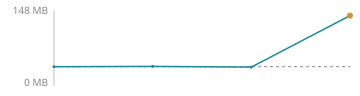 |
| `read/goad_toolkit/warm/phase/check` | 0.00 s | 0.00 s | +26% |  |
| `read/goad_toolkit/warm/phase/flow` | 0.01 s | 0.01 s | +24% |  |
| `read/goad_toolkit/warm/phase/page` | 0.02 s | 0.02 s | -10% |  |
| `read/goad_toolkit/warm/phase/read` | 0.01 s | 0.01 s | +27% |  |
| `read/goad_toolkit/warm/seconds` | 0.04 s | 0.04 s | -6% | 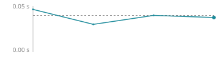 |
| `read/ordash/cold/linked/library` | 119 | – | – |  |
| `read/ordash/cold/linked/program` | 5 | – | – |  |
| `read/ordash/cold/peak_rss` suspect | 137 MB | 34 MB | +305% |  |
| `read/ordash/cold/phase/check` | 0.00 s | 0.00 s | +100% |  |
| `read/ordash/cold/phase/flow` | 0.00 s | 0.00 s | +50% |  |
| `read/ordash/cold/phase/page` | 0.01 s | 0.01 s | +13% |  |
| `read/ordash/cold/phase/read` | 0.18 s | 0.04 s | +401% |  |
| `read/ordash/cold/seconds` | 0.20 s | 0.05 s | +299% |  |
| `read/ordash/serve/first/seconds` | 0.21 s | – | – |  |
| `read/ordash/serve/peak_rss` | 137 MB | – | – |  |
| `read/ordash/serve/redraw/seconds` | 0.00 s | – | – |  |
| `read/ordash/serve/seconds` | 0.21 s | – | – |  |
| `read/ordash/unasked/linked/library` | 119 | – | – |  |
| `read/ordash/unasked/linked/program` | 5 | – | – |  |
| `read/ordash/unasked/peak_rss` | 137 MB | – | – |  |
| `read/ordash/unasked/phase/check` | 0.00 s | – | – |  |
| `read/ordash/unasked/phase/flow` | 0.00 s | – | – |  |
| `read/ordash/unasked/phase/page` | 0.01 s | – | – |  |
| `read/ordash/unasked/phase/read` | 0.00 s | – | – |  |
| `read/ordash/unasked/seconds` | 0.02 s | – | – |  |
| `read/ordash/warm/linked/library` | 119 | – | – |  |
| `read/ordash/warm/linked/program` | 5 | – | – |  |
| `read/ordash/warm/peak_rss` suspect | 137 MB | 31 MB | +339% |  |
| `read/ordash/warm/phase/check` | 0.00 s | 0.00 s | +100% |  |
| `read/ordash/warm/phase/flow` | 0.00 s | 0.00 s | +50% |  |
| `read/ordash/warm/phase/page` | 0.01 s | 0.01 s | +13% |  |
| `read/ordash/warm/phase/read` | 0.00 s | 0.00 s | +50% |  |
| `read/ordash/warm/seconds` | 0.02 s | 0.01 s | +20% |  |
| `read/private-1/cold/linked/library` | 0 | – | – |  |
| `read/private-1/cold/linked/program` | 1,664 | – | – |  |
| `read/private-1/cold/peak_rss` | 215 MB | – | – |  |
| `read/private-1/cold/phase/check` | 0.03 s | – | – |  |
| `read/private-1/cold/phase/flow` | 0.05 s | – | – |  |
| `read/private-1/cold/phase/page` | 0.04 s | – | – |  |
| `read/private-1/cold/phase/read` | 12.51 s | – | – |  |
| `read/private-1/cold/seconds` | 12.66 s | – | – |  |
| `read/private-1/serve/first/seconds` | 12.91 s | – | – |  |
| `read/private-1/serve/peak_rss` | 197 MB | – | – |  |
| `read/private-1/serve/redraw/seconds` | 0.00 s | – | – |  |
| `read/private-1/serve/seconds` | 12.91 s | – | – |  |
| `read/private-1/unasked/linked/library` | 0 | – | – |  |
| `read/private-1/unasked/linked/program` | 1,664 | – | – |  |
| `read/private-1/unasked/peak_rss` | 137 MB | – | – |  |
| `read/private-1/unasked/phase/check` | 0.03 s | – | – |  |
| `read/private-1/unasked/phase/flow` | 0.05 s | – | – |  |
| `read/private-1/unasked/phase/page` | 0.05 s | – | – |  |
| `read/private-1/unasked/phase/read` | 0.06 s | – | – |  |
| `read/private-1/unasked/seconds` | 0.21 s | – | – |  |
| `read/private-1/warm/linked/library` | 0 | – | – |  |
| `read/private-1/warm/linked/program` | 1,664 | – | – |  |
| `read/private-1/warm/peak_rss` | 137 MB | – | – |  |
| `read/private-1/warm/phase/check` | 0.03 s | – | – |  |
| `read/private-1/warm/phase/flow` | 0.05 s | – | – |  |
| `read/private-1/warm/phase/page` | 0.05 s | – | – |  |
| `read/private-1/warm/phase/read` | 0.06 s | – | – |  |
| `read/private-1/warm/seconds` | 0.21 s | – | – |  |
| `read/vectormesh/cold/linked/library` | 0 | – | – |  |
| `read/vectormesh/cold/linked/program` | 273 | – | – |  |
| `read/vectormesh/cold/peak_rss` | 137 MB | 93 MB | +48% | 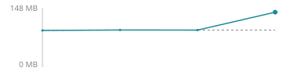 |
| `read/vectormesh/cold/phase/check` | 0.00 s | 0.00 s | +33% |  |
| `read/vectormesh/cold/phase/flow` | 0.01 s | 0.01 s | -18% |  |
| `read/vectormesh/cold/phase/page` | 0.02 s | 0.02 s | -27% |  |
| `read/vectormesh/cold/phase/read` suspect | 1.56 s | 0.91 s | +72% | 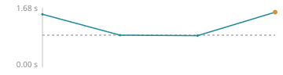 |
| `read/vectormesh/cold/seconds` suspect | 1.60 s | 0.94 s | +69% | 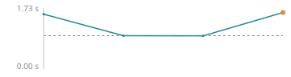 |
| `read/vectormesh/serve/first/seconds` | 1.63 s | – | – |  |
| `read/vectormesh/serve/peak_rss` | 137 MB | – | – |  |
| `read/vectormesh/serve/redraw/seconds` | 0.00 s | – | – |  |
| `read/vectormesh/serve/seconds` | 1.63 s | – | – | 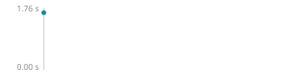 |
| `read/vectormesh/unasked/linked/library` | 0 | – | – |  |
| `read/vectormesh/unasked/linked/program` | 273 | – | – |  |
| `read/vectormesh/unasked/peak_rss` | 137 MB | – | – |  |
| `read/vectormesh/unasked/phase/check` | 0.00 s | – | – |  |
| `read/vectormesh/unasked/phase/flow` | 0.01 s | – | – |  |
| `read/vectormesh/unasked/phase/page` | 0.02 s | – | – |  |
| `read/vectormesh/unasked/phase/read` | 0.01 s | – | – |  |
| `read/vectormesh/unasked/seconds` | 0.05 s | – | – | 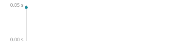 |
| `read/vectormesh/warm/linked/library` | 0 | – | – |  |
| `read/vectormesh/warm/linked/program` | 273 | – | – |  |
| `read/vectormesh/warm/peak_rss` suspect | 137 MB | 40 MB | +239% | 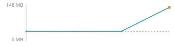 |
| `read/vectormesh/warm/phase/check` | 0.00 s | 0.00 s | +33% |  |
| `read/vectormesh/warm/phase/flow` | 0.01 s | 0.01 s | -17% |  |
| `read/vectormesh/warm/phase/page` | 0.02 s | 0.02 s | -11% |  |
| `read/vectormesh/warm/phase/read` | 0.01 s | 0.01 s | +24% |  |
| `read/vectormesh/warm/seconds` | 0.05 s | 0.05 s | -1% | 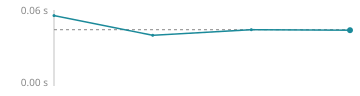 |

## Tests

| measure | last | baseline | change | runs |
| --- | ---: | ---: | ---: | --- |
| `tests/atlas-code/atlas-code/seconds` | 0.19 s | 0.88 s | -79% |  |
| `tests/atlas-code/exit/seconds` | 0.09 s | 0.11 s | -20% |  |
| `tests/atlas-code/help/seconds` | 0.01 s | 0.01 s | +32% |  |
| `tests/atlas-code/history/seconds` | 0.30 s | 0.24 s | +25% |  |
| `tests/atlas-code/mcp/seconds` | 0.75 s | 0.49 s | +54% |  |
| `tests/atlas-code/serve/seconds` | 12.10 s | 12.28 s | -1% |  |
| `tests/atlas-code/view/seconds` | 0.29 s | 0.19 s | +51% |  |
| `tests/atlas-engine/arrows/seconds` | 0.10 s | 0.10 s | -8% |  |
| `tests/atlas-engine/aside/seconds` | 0.64 s | 0.26 s | +147% |  |
| `tests/atlas-engine/cache/seconds` | 0.77 s | 0.35 s | +120% |  |
| `tests/atlas-engine/changes/seconds` | 0.50 s | 0.22 s | +128% |  |
| `tests/atlas-engine/composition/seconds` suspect | 1.15 s | 0.65 s | +78% | 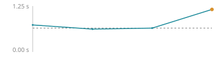 |
| `tests/atlas-engine/diff/seconds` suspect | 1.77 s | 0.91 s | +96% | 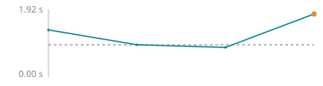 |
| `tests/atlas-engine/environment/seconds` | 0.05 s | 0.04 s | +32% |  |
| `tests/atlas-engine/laws/seconds` | 0.04 s | 0.03 s | +69% |  |
| `tests/atlas-engine/lib/seconds` suspect | 0.93 s | 0.32 s | +191% | 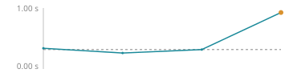 |
| `tests/atlas-engine/libraries/seconds` | 0.36 s | 0.29 s | +25% |  |
| `tests/atlas-engine/library_depth/seconds` | 0.46 s | 0.31 s | +48% |  |
| `tests/atlas-engine/merge/seconds` | 0.02 s | 0.03 s | -54% |  |
| `tests/atlas-engine/named/seconds` suspect | 1.17 s | 0.66 s | +75% | 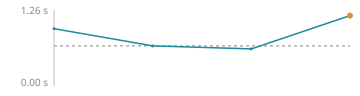 |
| `tests/atlas-engine/one_name/seconds` | 0.95 s | – | – |  |
| `tests/atlas-engine/pairs/seconds` suspect | 1.37 s | 0.41 s | +234% |  |
| `tests/atlas-engine/pairs_aliases/seconds` | 0.70 s | 0.55 s | +26% |  |
| `tests/atlas-engine/pairs_body/seconds` | 0.89 s | 0.54 s | +65% |  |
| `tests/atlas-engine/pairs_figures/seconds` suspect | 16.52 s | 8.17 s | +102% | 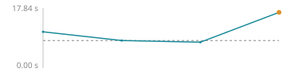 |
| `tests/atlas-engine/pairs_loops/seconds` | 0.24 s | 0.10 s | +136% |  |
| `tests/atlas-engine/pairs_pipeline/seconds` | 0.39 s | 0.16 s | +153% |  |
| `tests/atlas-engine/pairs_python/seconds` suspect | 15.79 s | 4.27 s | +269% |  |
| `tests/atlas-engine/pairs_readback/seconds` | 0.33 s | 0.36 s | -9% |  |
| `tests/atlas-engine/pairs_rust/seconds` suspect | 4.97 s | 1.72 s | +189% | 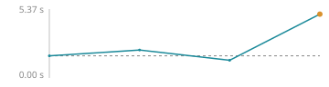 |
| `tests/atlas-engine/pairs_storage/seconds` | 0.47 s | 0.22 s | +112% |  |
| `tests/atlas-engine/pairs_typescript/seconds` suspect | 3.96 s | 1.46 s | +171% |  |
| `tests/atlas-engine/parse/seconds` suspect | 36.90 s | 20.67 s | +79% | 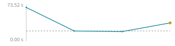 |
| `tests/atlas-engine/parts/seconds` | 1.38 s | 1.03 s | +34% |  |
| `tests/atlas-engine/plans/seconds` suspect | 206 s | 114 s | +81% |  |
| `tests/atlas-engine/principles/seconds` | 0.98 s | 0.60 s | +65% |  |
| `tests/atlas-engine/prophetize/seconds` | 0.01 s | 0.01 s | +50% |  |
| `tests/atlas-engine/python_reader/seconds` | 0.36 s | 0.17 s | +118% |  |
| `tests/atlas-engine/ran_before/seconds` | 1.23 s | – | – |  |
| `tests/atlas-engine/readers/seconds` | 0.30 s | 0.14 s | +110% |  |
| `tests/atlas-engine/reading_order/seconds` | 0.25 s | – | – |  |
| `tests/atlas-engine/remote/seconds` | 0.12 s | 0.15 s | -19% |  |
| `tests/atlas-engine/resolution/seconds` | 0.54 s | 0.28 s | +95% |  |
| `tests/atlas-engine/review/seconds` suspect | 32.26 s | 18.30 s | +76% | 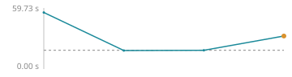 |
| `tests/atlas-engine/route_text/seconds` | 1.11 s | – | – |  |
| `tests/atlas-engine/rust_facts/seconds` | 0.05 s | 0.05 s | -17% |  |
| `tests/atlas-engine/rust_reader/seconds` | 0.05 s | 0.05 s | +10% |  |
| `tests/atlas-engine/sample/seconds` | 0.00 s | 0.02 s | -83% |  |
| `tests/atlas-engine/story/seconds` | 0.04 s | 0.01 s | +324% |  |
| `tests/atlas-engine/typescript/seconds` suspect | 38.95 s | 0.11 s | +36649% | 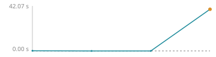 |
| `tests/atlas-engine/versions/seconds` | 0.11 s | – | – |  |
| `tests/atlas-engine/wording/seconds` suspect | 1.28 s | 0.68 s | +90% | 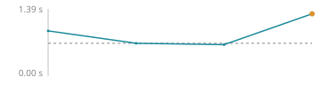 |
| `tests/atlas-engine/workspace_index/seconds` | 0.39 s | 0.18 s | +111% |  |
| `tests/total/seconds` suspect | 391 s | 195 s | +101% |  |
