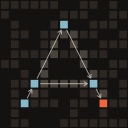

<p align="center">
  
</p>

<h1 align="center">Atlas</h1>

<p align="center">
  <b>See how code works: where data rests, and the functions that carry it there.</b>
</p>

<p align="center">
  <a href="https://claude.com/claude-code"></a>
  <a href="LICENSE"></a>
  
  
</p>

Atlas draws a codebase as a map. It does not show files and folders. It shows what the
program *does*: where data rests (a file, a database table, a web API, the screen, a
value in memory) and the functions that carry it from one place to the next, in the
order they run. Point it at a repository, pick an entry point (a command, a web
route, a test, a notebook) and follow it from what it reads to what it writes.

## Why: a shared language

Atlas is built for a human and a coding agent who write software together. Each of them
sees something the other misses. The human sees shapes: a box that should not be there,
an arrow that runs the wrong way, a name that does not fit. The agent sees every type,
call and effect at once. Explaining either of those in prose is slow and imprecise.

So Atlas gives both of them one picture, and the picture is mathematics you can look at:

| In the code | In the picture |
| --- | --- |
| where data rests: a value of a type, a file, a table, a URL, the screen | a **place** (a box) |
| a function | an **arrow** from what it takes to what it gives back or writes |
| calling one function after another | **composition**: arrows chained into a route |
| a base class and its subclasses, a type and its parts | **zoom**: one box that opens into a family |

Because the picture follows these rules, pointing at a box and saying "this should not
exist" is a precise statement. The agent knows exactly which code you mean, and you can
see exactly what the agent means. The same rules make a design problem visible: when
the code is clean, the picture is simple. When the picture looks wrong, the code usually
is. Atlas never draws anything the code does not say.

## Reading the picture

Here is Atlas looking at itself: the route `analyze`, which is what Atlas does when it
reads a repository.

<picture>
  <source media="(prefers-color-scheme: dark)" srcset="docs/img/flowchart-dark.png">
  
</picture>

Read it from left to right:

- **On the left** are the places the route reads: `Disk in`, the repository's files. The
  green `>_` box is where the route starts.
- **In the middle** are the steps. A rounded pill is a function. A box with a coloured
  bar is a value of a type in memory: `Options`, `Repo`, `Graph`. Arrows run in
  call order.
- **Read it as a sentence:** *read* the repository into a `Repo`, and make its `graph_of`
  with the `Options` of the reading. That is Atlas's whole job, and the code says it in two
  calls.
- **A solid line is what a step itself takes, a dashed line what a closed pill reaches
  inside.** `read` lists the files through `Repo.read`, and finds the project of a package
  named on its own; `graph_of` takes no file, but the readers inside it ask the `Repo` for a
  file's text, which is read from disk the first time it is asked for.
- **`Repo (2)` and `Graph (7)` are families**: a type and the types that belong to it or
  that it holds, folded into one box. Click one to open it. A config opens the same way
  into what it holds (`folders: Folders`). Inside `graph_of`, `parse · one of 3` is a
  choice: the same call goes to the Python, the Rust or the TypeScript reader.
- **Click any pill** to open it into its own steps, and **show code** to see its source.
- **A step is a call.** A function the route calls twice is two steps, and a method called
  on a subclass's value is that subclass's (`ComparePlot.plot`). Values are drawn by the
  names the code holds them by (`Graph · g`, `DataFrame · data`), and a step that changes a
  value hands it on under the same name. A library operation Atlas does not read is a step in
  italics where the code names its result (`to_numpy`). In a notebook, each call that makes
  a figure makes its own (`Figure 3 · ResidualPlot.plot`).
- **Files fold into their folders** once a picture holds more than a column's worth:
  `File(artefacts/) · 8` opens into what is in it with a click.
- **Shift-click a package** in the overview to focus on it: the picture keeps the packages
  in focus, the types that cross between them and the places they touch, and joins the
  rest of the code by counted arrows on either side. Click the rest to open it into the
  packages that hand the focus data or take data from it, and click one of those to add
  it to the focus. The state bar names the packages around the focus, the most exchanged
  first, to add with one click.
- **A vermilion dot in a corner is a finding** of `atlas check` (below) about that box, pill
  or route: hover the dot for what Atlas sees there and the question it asks. The dot sits
  inside its box, so findings move no box and no line. Atlas's own picture has none.
- **Double-click a box** to pin its lines, to study or compare what it connects.
- **Space over a box** shows its details and code over the picture while the code panel is
  closed; space, Esc or a click on the picture puts them away, and **pin** keeps the panel
  open beside the picture.
- **Press `?`** in the page for every key and click on one card.

The same route as text, with its steps in call order, is the MCP tool `route` (see below).

## Install

**macOS and Linux**, a prebuilt binary into `~/.local/bin`:

```bash
curl -fsSL https://raw.githubusercontent.com/raoulg/atlas/main/install.sh | sh
```

**Windows**, in PowerShell, into `%LOCALAPPDATA%\Programs\atlas` and onto your `PATH`:

```powershell
irm https://raw.githubusercontent.com/raoulg/atlas/main/install.ps1 | iex
```

**From source**, with a [Rust toolchain](https://rustup.rs):

```bash
cargo install --locked --git https://github.com/raoulg/atlas atlas
```

## Use

```bash
atlas view                      # draw the repository you are in; opens in your browser
atlas view ../api ../web        # two repositories as parts of one picture
atlas view notebooks/explore.ipynb   # one file, with its project, opened on its route
atlas view https://github.com/o/r/tree/main/src/pkg   # one folder of a repository, from its URL
atlas check                     # where the code and the design principles disagree
atlas changes                   # what your edits did to the routes, their places and the findings
atlas --help
```

`atlas view` writes a single HTML file and opens it. No server runs and your code stays on
your machine. The page fetches only its drawing libraries (d3, elk, highlight.js) from a
CDN. It has three views. The **Flowchart** is the one to start with. Type lattice and
Signature flow are earlier experiments. The header names the build that drew
the page, as `atlas --version` does: `0.4.0 (b0ead14)`. The minor number goes up when what
Atlas reads or draws changes, the patch number for a fix.

Atlas reads:

- **Python**: the packages `pyproject.toml` names (Hatch's, setuptools' or Poetry's
  `packages`, else the project's name) and every other package beside them, and the
  project's scripts and notebooks at any depth (`.py` and `.ipynb` outside the packages,
  its tests and what git ignores; a project of only scripts and notebooks needs no package,
  and a file you name is read even where git ignores it), with
  its types from [ty](https://docs.astral.sh/ty/). The library modules its code calls are
  read from its environment too, so a library's own steps can be opened in a route;
  `--libraries 2` reads one step further into those libraries, `--libraries 0` not at all.
  Libraries with compiled code and the ones Atlas already knows (pandas, requests, torch, …)
  stay closed;
- **Rust**, including workspaces;
- **TypeScript and TSX**: React components, server routes (Hono, Express, Fastify), TanStack
  routes and server functions, `tsconfig` paths.

A repository can hold several parts: a Python API and a TypeScript app, the crates of a
workspace, the members of a uv workspace. Atlas finds every `Cargo.toml`, `pyproject.toml`
and `package.json` itself, at any depth, and reads each part in its own language. The overview then shows each part as one step, from
what it reads to what it writes. Where one part names a route another part serves (the app
asks for `/api/items/{id}`, a FastAPI app mounted at `/api` serves `/items/{id}`), the two
meet in that part's `HTTP`. Click a part to open it; **Only *part*** in the menu keeps to
one.

A part opens into its packages, each as one step from what its own code reads to what it
writes. Between packages stand the types that cross them: data one package makes and
another takes. A sink or a repository is not drawn as a type there: it is a door to its
database, and the database is drawn. A dotted line joins a package to one it only calls.
A package opens into its subpackages, and a module into its routes and the functions other
packages call in it. This overview stands even when Atlas finds no entry points.

Atlas reads Python's types through ty, Astral's type checker, with the project's own
environment: the one `[tool.ty.environment]` in `pyproject.toml` names, else the project's
`.venv`. A venv that is active in your shell is not the project's and is not read. Where ty does not know a type, Atlas does not guess, so the picture is as
precise as the code's annotations. It sees best when:

- the environment is synced (`uv sync`), so that libraries have types. Without one, Atlas
  still knows a call to `requests.get`, but not what the value it gives back is;
- every parameter and every return is annotated. Ruff's `ANN` rules ask for both:

  ```toml
  [tool.ruff.lint]
  extend-select = ["ANN"]
  ```

- a variable is annotated where its value says nothing: an empty container
  (`nodes: list[Node] = []`) or `None` to begin with (`self.conn: Connection | None = None`).
  ty infers the rest.

`atlas check` asks for a return annotation where callers use what a function gives back.

Entry points come from the code itself. Atlas finds:

- the programs and plugins a `pyproject.toml` declares (`[project.scripts]`,
  `[project.gui-scripts]`, `[project.entry-points]`, `[tool.poetry.scripts]`), `package.json`
  `bin` and scripts that run a file of the package, and a Rust binary's `main`;
- commands (`@app.command` from click or typer, by the name that framework gives it);
- web routes (`@app.get("/…")` and `@app.route("/…", methods=[…])` from FastAPI or Flask,
  Litestar's `@get("/…")`, `app.get("/…", handler)` as in Hono and Express, each at the full
  path of the routers it is mounted on, and TanStack file routes);
- MCP tools, Makefile targets, scripts, notebooks and tests;
- what a library exports: at its root (in TypeScript the module `package.json` points to), and
  in Rust also through `pub mod` and `pub use`.

### Check: the picture as a list of questions

`atlas check` reads the same graph and lists where the code and ten design principles
disagree. Each finding ends in a question for the author. Atlas coaches; it does not fix.

| Principle | In one line |
| --- | --- |
| `doors` | A package names its doors, and each door says what goes in and what comes out. |
| `sums` | A sum type is unwrapped where it arises. |
| `overrides` | An override keeps the promise of its base. |
| `places` | Library code does not decide where data lives. |
| `changes` | A change to an input shows in the signature. |
| `gives` | A function whose value is used says what it gives back. |
| `choices` | A choice is made once, in a place with a name. |
| `nothing` | A call leaves something behind. |
| `layers` | The packages of a part depend on one another in one direction. |
| `lens` | What a lens puts, it gets back. |

Each principle, with its reasoning and the Python and Rust idioms behind it, is in
[docs/principles.md](docs/principles.md). Atlas holds itself to them: `atlas check` on
this repository finds nothing, and the tests keep it that way.

### Changes: what an edit did

`atlas changes [<rev>]` reads the working tree against a git revision (`HEAD` by default)
and lists what the edit did: the routes added and removed, the steps and places each route
gains and loses, and the findings it raises and resolves. In a design loop, that is the
question after every step: does the change do what it was meant to, and nothing else? The
revision is read from git into a directory of its own; the working tree and the index stay
as they are. `atlas view --since <rev>` draws the same changes on the picture: a changed route
is marked in the route list, the steps and places it gained are outlined, and the inspector
lists what came and what went.

```text
since HEAD

~ API · POST /api/regels
    - step server.regels.vat
    - place asks an LLM create
```

### Give your coding agent the same picture

`atlas mcp` serves Atlas over the [Model Context Protocol](https://modelcontextprotocol.io).
The tools are `principles`, `check`, `explain`, `routes`, `route` and `changes`; `route`
returns what one entry point does, step by step, and `changes` what the working tree did
since a commit, so an agent can check its edit against what it was meant to do. In [Claude Code](https://claude.com/claude-code):

```bash
claude mcp add atlas -- atlas mcp
```

Any other MCP client takes the same command: `{"command": "atlas", "args": ["mcp"]}`.

## How it works

Atlas is a Rust workspace. `engine/` parses a repository with
[tree-sitter](https://tree-sitter.github.io) into a graph of modules, types, functions,
calls and the places they touch; Python's types come from
[ty](https://github.com/astral-sh/ty). It computes routes, families and findings from that
graph. `cli/` is the `atlas` command. The viewer is a single HTML file
(`viewer/index.html`) baked into the binary.

The engine knows languages and libraries, never a particular project, and a repository
declares nothing to Atlas: the picture comes from the code alone. When it looks wrong, the
code is what to change. The full design, from the algebra to the views, is in [docs/design.md](docs/design.md).

```bash
cargo test                       # fixtures in three languages, and Atlas reading itself
cargo install --path cli         # rebuild after editing viewer/index.html
```

## Status

**Alpha.** Atlas is young and moves fast: what it reads and draws changes from one minor
version to the next. The viewer is still the prototype that proved the idea.
Python, Rust and TypeScript are read. More languages, one graph for a project that spans
several languages, and git history are next.

## Built with Claude

Atlas is built the way it is meant to be used: by a human and an agent together. Raoul
Grouls designs it with [Claude Code](https://claude.com/claude-code). Atlas is also
Claude's way of showing what it sees in a codebase.

## License

[CC BY-NC-SA 4.0](LICENSE): use, change and share Atlas with attribution, not commercially,
and share changed versions under the same licence. For commercial use, ask.
