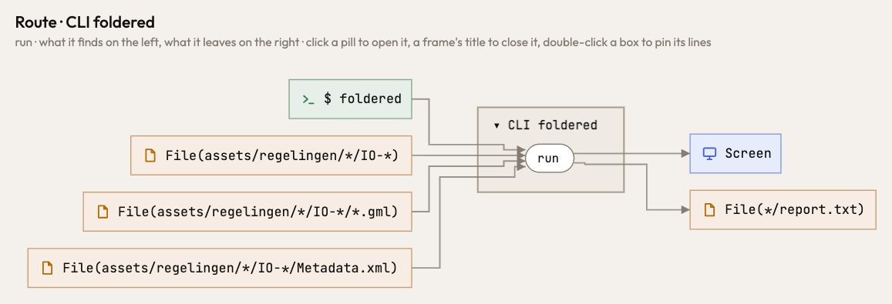
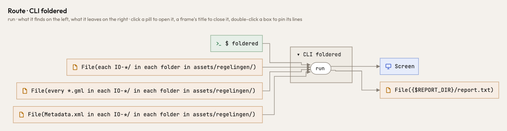

A path whose folder the code leaves open used to read as `*`, the same sign as a glob's wildcard, and the page folded
every such place into one `*/` box, whatever the folders were. Now the open part keeps the name the code gives it
(`{$REPORT_DIR}/report.txt`, `{base_dir}/…`), so two different folders stay two boxes. A folder the program lists and
then reads in is one folder (`…/IO-*/`), not a file beside its own contents. A file place says its pattern in words, from
the file up: `every *.gml in each IO-*/ in each folder in assets/regelingen/`. The path as the code writes it is under
the pointer, and stays the place's identity.

Before and after, the same program (`for io_dir in ASSETS.glob("*/IO-*")`, reading `Metadata.xml` and `*.gml` in each,
and writing `report.txt` where `REPORT_DIR` says):

