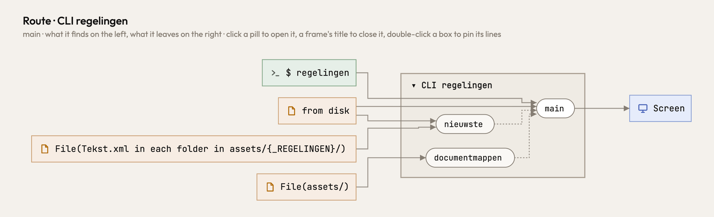
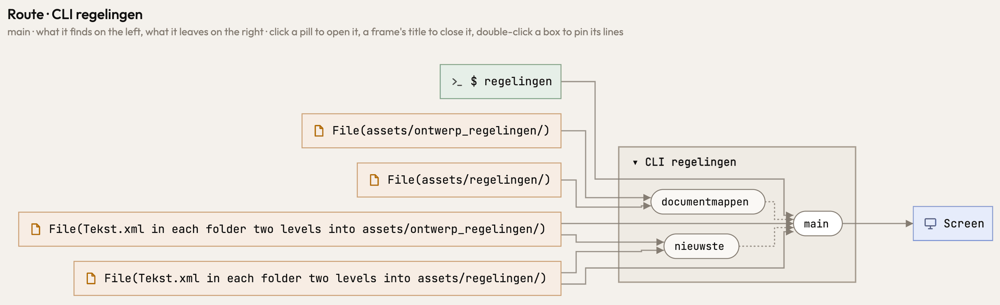

Python's places lost a part where the code says it. The `p` of `for p in root.iterdir()` stood for `root` itself,
so every place below it lost a folder (`assets/regelingen/*/Tekst.xml` where the code reads
`assets/regelingen/*/*/Tekst.xml`); now it is `root/*`, as for `root.glob("*")`, `os.listdir` (its names joined
back below the directory) and `os.scandir` (its entries' `path`), and the listing itself reads `root/`. The parameter of a sort key, `sorted(ps, key=lambda p:
p.stat().st_mtime)`, read an unnamed file (`from disk`); it is one of the paths it sorts, as is the parameter of `max`,
`min`, `list.sort` and `map`, and what `max`, `next` or `sorted(..)[-1]` picks of them. `ASSETS / KINDS[variant]`,
`KINDS` a mapping the code writes, was `assets/` with a hole; it is each folder the mapping names, and a key the code
writes picks its own.

Before and after, the same program (`documentmappen(ASSETS / _REGELINGEN[variant])` lists with `iterdir()`, and
`nieuwste(m)` takes the newest `*/Tekst.xml` in each folder by its `stat()`):

