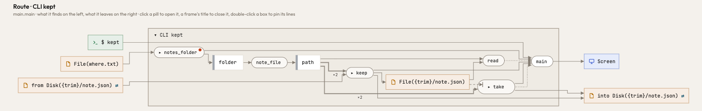
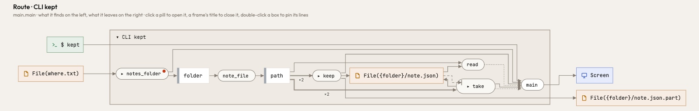

A file renamed into place or removed was drawn as a place of its own, `Disk(…)` with the path as its label, beside the
`File(…)` the same file is read from and written to. Now a file is one place whatever touches it: a write, a read, a
rename into it or out of it, a copy, its removal. A part of a path no code decides keeps the name the code binds the
value to (`let folder = notes_folder()?` gives `{folder}/note.json`), in Python, Rust and TypeScript alike; a call no
name holds is `{}`, never the name of the function or method it calls (`{trim}`, `{new}`, `{TemporaryDirectory}`). A
suffix given to a path a caller hands (`path.with_extension("json.part")`, `with_suffix`) is applied once the caller
says the path, so the partial file of an atomic write is a file of its own.

Before and after, a note written whole beside its file and renamed in, read, and removed (`tests/pairs/kept/rust/clean`):

On Atlas itself, `.atlas/look.json` is one place for `shared::read`, the rename at the end of `shared::write` and the
`remove_file` of `take_look` (`File({out}/.atlas/look.json)`; `{out}` is what `repo::normal` binds the path it builds
to), and the partial file is `{out}/.atlas/look.{}.part`.
