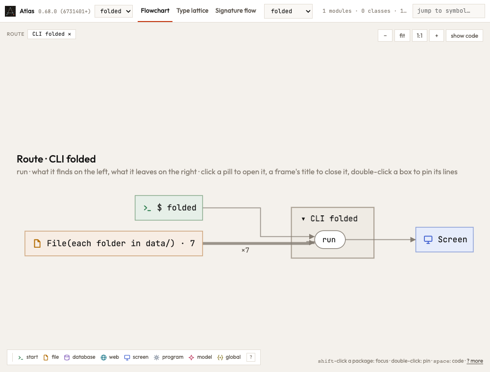
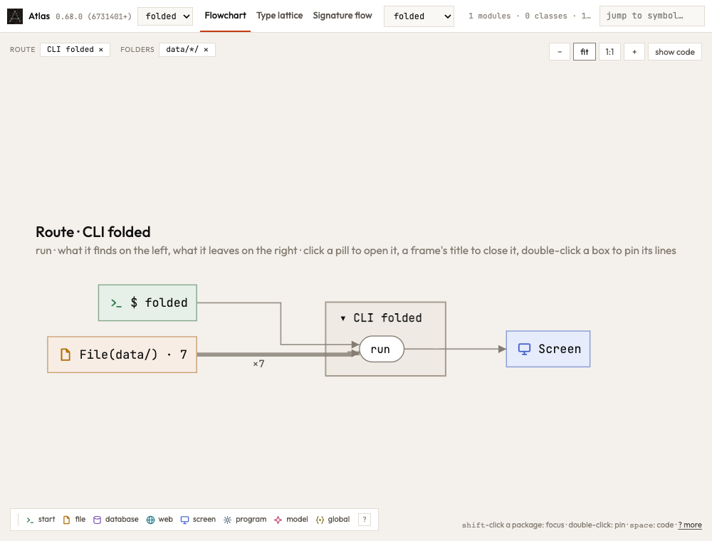
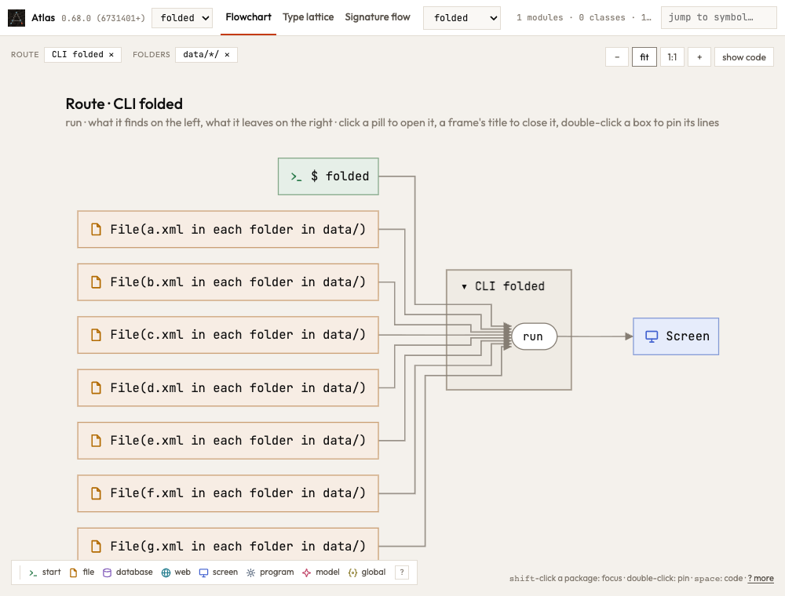

Past a column's worth of files, the page folds them into the folders that hold them. When a folder and the folder below
it hold the same files (`data/` and each folder in it), the box is drawn as the deeper one; a click on it opened only
that one, so the files folded into the shallower folder again and the box only got shorter. Now folders nested in one
another that hold the same files are one box, and a click opens them all: the files stand in one step, and the folder's
chip closes them back into the box.

The same program (seven `ROOT.glob("*/x.xml")` reads under `data/`), closed, then opened once, before and after:

