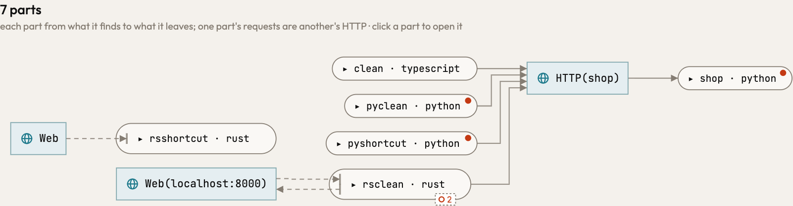
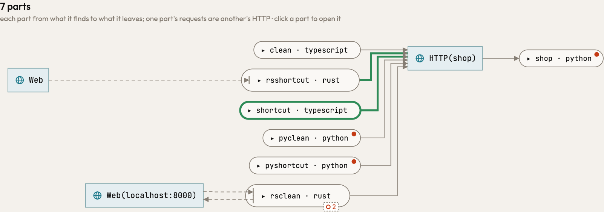

A key no code decides into a table the code writes was a hole in TypeScript and Rust: `DEFAULT_PATHS[found!.env]`
of a `Record<string, string>` written as an object, and `paths[key]` or `paths.get(key)` of a
`HashMap::from([..])`, named no path, so a client that looks its paths up in such a table asked an address the code
does not say and met no route. Now it is one of the values the table holds, and a key the code writes picks its own,
as Python's `PATHS[key]` is: the shortcut client meets the routes at the paths its table holds, in all three
languages alike. The same goes for an array, a `vec!` and `X.key` of an object. A listing of a directory yields
`D/*` in every language: Rust's `fs::read_dir(D)` with its entries at `entry.path()`, Node's `readdirSync(D)` with the
names the code joins back (`path.join(D, name)`), looped over or handed to `map`, `for_each` or `forEach`, as
Python's `iterdir()` and `os.listdir` do. A `for` loop and a closure an iterator runs on each element take one of the
elements, and reqwest's `client.request(method, url)` asks at its URL.

Before and after, the requests pair (`engine/tests/pairs/requests`): the TypeScript and Rust shortcuts now reach
`HTTP(shop)`, as the Python shortcut already did:

