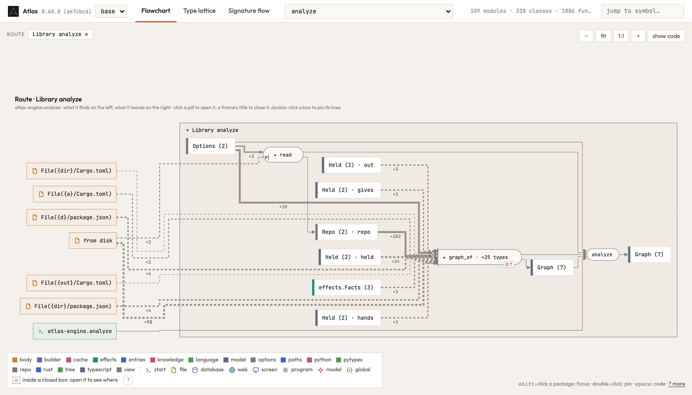
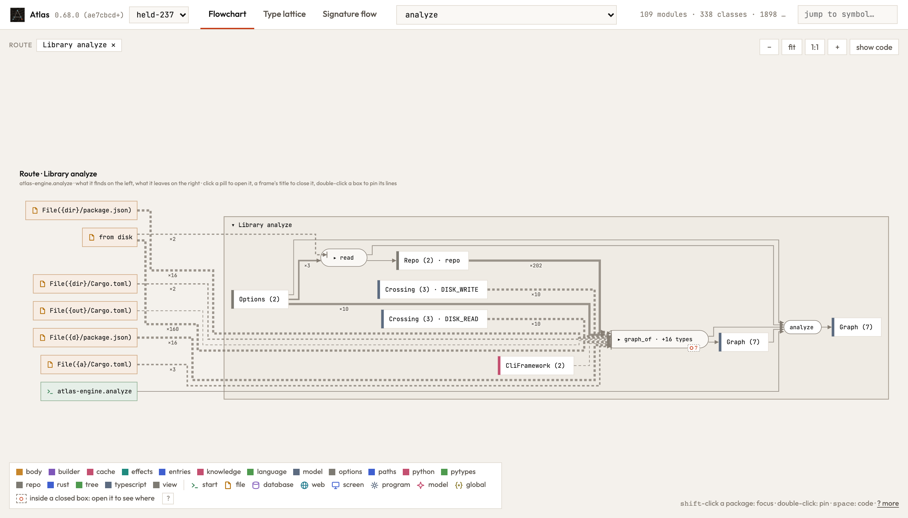

A route drew values its own code makes as if they came from outside it, on the left of the step that uses them. Two
readings were at fault. A call into a function the route is already inside (`below` calling `split` again) was drawn as a
step without a body, so the names its body binds (`mine`, `rest`) looked like a module's constants, and the outer call's
`mine` was even wired into the inner call. It is now a closed step: it takes what its call hands it, gives what its call
gives, and reaches what its function reaches (dashed). And a list made by a literal (`let mut held = vec![]`,
`items = []`) and filled by a function it is handed to came from beyond, where `Vec::new()` or `list()` drew it made
inside; the graph now says that a body binds a name by a literal, and both forms draw alike.

A module's constant still comes from beyond, as it should, and the Rust reader now sees one (`const FLOOR: Floor`), as the
Python and TypeScript readers did: on Atlas's own route `analyze`, `DISK_READ`, `DISK_WRITE` and the `CliFramework`
table stand where the four `Held` boxes (`hands`, `gives`, `held`, `out`) stood. `new Array<Item>()` in TypeScript gives
a list of `Item`, as `[]` written for an `Item[]` does.

Atlas's route `analyze`, closed, before and after:

