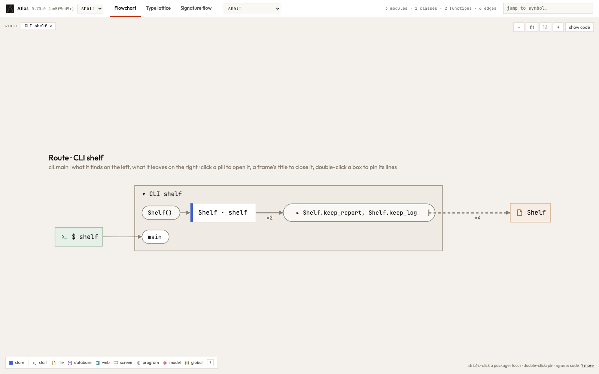
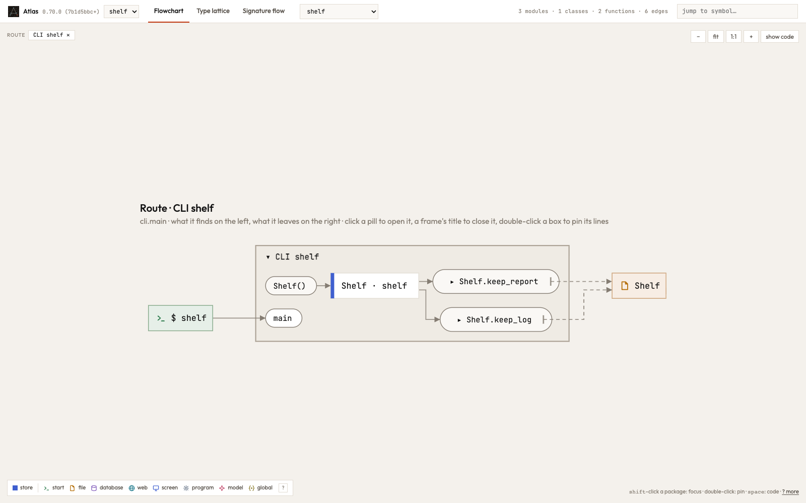
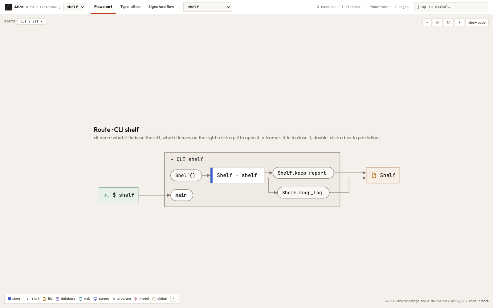

A place whose path several callers make whole together is written only under a step where all of them are on the calls.
Atlas wrote "both callers" in the order it read them, so `a&b` and `b&a` were two answers to one question. They are one
now: the callers of each conjunction and the alternatives are sets, written in order in the graph's JSON (#276). That
step draws nothing otherwise; what the JSON writes for 13 of 292 programs (the pairs, and Atlas itself) is the same sets
in order, where an alternative written twice in two orders is written once:

```text
diamond/typescript/shortcut, the touch of `store.Store.get`:
  before  "by": ["news.read.headlines", "news.sources.Cached.constructor&news.read.headlines",
                 "news.read.headlines&news.sources.Cached.constructor", "news.sources.Cached.constructor"]
  after   "by": ["news.read.headlines", "news.read.headlines&news.sources.Cached.constructor",
                 "news.sources.Cached.constructor"]
```

Where the callers meet, Atlas kept one of them and dropped the other when the path was handed more than one level up
(#279). A shelf whose folder `main` sets up, and whose methods each name a file in it and hand the path to one `write`,
drew both methods writing both files: the method that names the file was dropped, so the two steps had the same arrow
and folded into one box that wrote the shelf four times. Now each method writes its own file, as the shortcut, which
writes each file in its method, always drew it. The lines stay dashed on the clean side, since the writing is the
helper's, reached through each method; the shortcut's are solid, its methods' own.







Atlas itself moves the same way: `shared.write` writes `.atlas/timings.json` under `set_timings`, `shown.json` under
`set_shown`, and so on for its seven files, where every step that set up the workbench wrote all seven. No call or request
between functions moves, and no finding.
