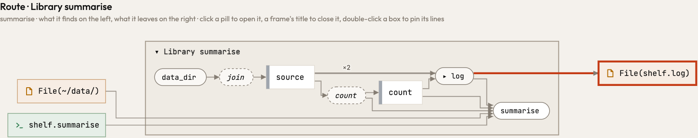
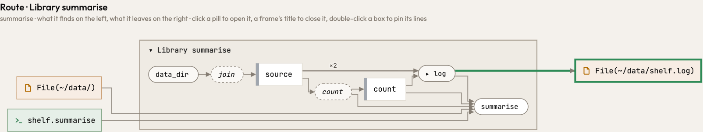

`OpenOptions::new().append(true).create(true).open(folder.join("shelf.log"))` was read as a call to `create`, the
option, so the file was the literal the call held, `shelf.log`, wherever `folder` was. Now the options say only how
the file opens (here: it is written), and the file is the path `open` is handed, followed through the callers as
`fs::write`'s path is: in the `parents` pair the log rests beside the data files, `File(~/data/shelf.log)`, as it
does for Python's `open(.., "a")` and TypeScript's `appendFileSync`. Atlas itself now shows which lock files
`atlas-code serve` writes (`{subject}/.atlas/notes.lock` and the others).

The route of `summarise` in the `parents` pair, which adds a data file's line count to a log in its directory. Before,
the log is a file named by a literal; after, the file in the data files' directory:

