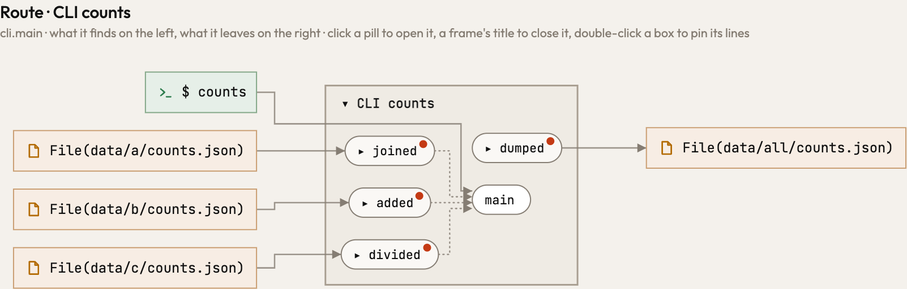

Nothing a user sees changes: the rule is internal. `os.path.join("data", kind)`, `"data/" + kind` and
`Path("data") / kind` make one path, and a function that builds one from a literal decides where data lives, whichever
form it writes. Atlas already drew them alike, through the path functions ty finds (`os.path.join` is `posixpath`'s or
`ntpath`'s); now the second place that asks, whether a call's path or URL starts at a literal, asks the same table
instead of knowing pathlib's classes alone. The classes that say a library function is handed a file to read, one to
write or an open file (`SupportsRead`, `SupportsWrite`, `typing.IO`, `io`'s classes) are a table as well, and hold where
ty finds them in `_typeshed`, `typing`, `io` and `_io`: a class of the same name elsewhere is no file.

The picture is a command that reads counts through each form and writes them through `os.path.join`, drawn by the build
before and after alike: each function is a place's own decider (the red dot asks who should decide), and `json.load` and
`json.dump` go the way their parameters' classes say. `atlas-code analyze --no-cache` gives the same JSON with both
builds for Atlas and for each of the 301 programs under `engine/tests/pairs`.

