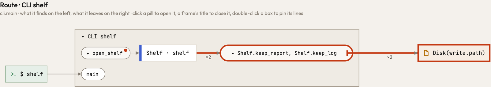
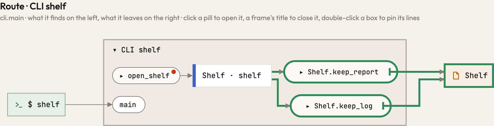

A shelf is handed its folder when it is built, and each of its methods names its own file in that folder and hands the
path to one `write`. Here `main` sets the shelf up in a step of its own, `open_shelf`, and keeps its report and its log
in the steps after. Before, the page drew the path as it was read, `Disk(write.path)`, so the two methods drew the same
arrow and folded into one box that wrote that one place twice. The step that set the shelf up ran beside the methods,
not above them, and the page only counted callers on the calls that lead to a step.

Now a step counts the callers that ran before it in the route. A caller that set the object up counts wherever it ran
earlier; a caller that hands the rest of the path counts only on those calls. So each method writes its own file,
`out/report.txt` under `keep_report` and `out/log.txt` under `keep_log`, as it does when `main` builds the shelf itself
(the `handing` pair).

