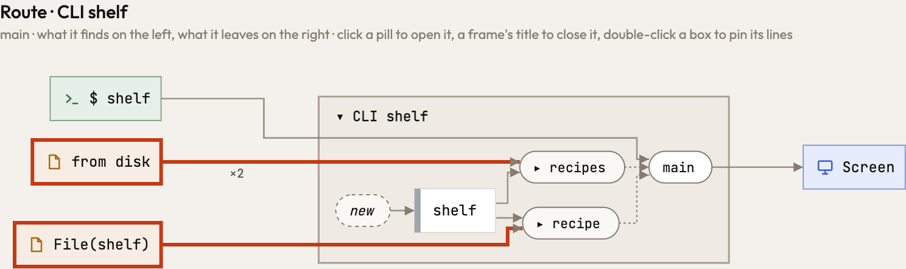
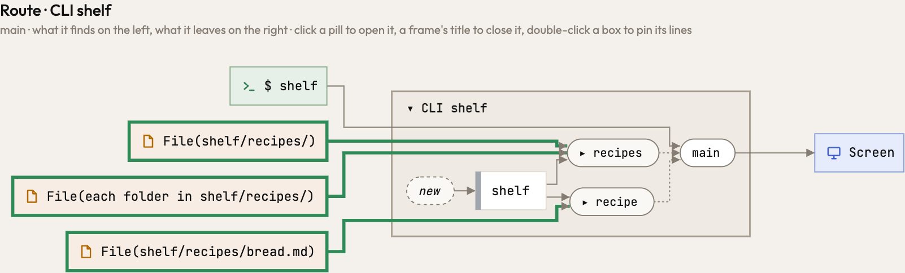

A `PathBuf` that is built with `push`, `set_extension` or `pop` was a value Atlas did not follow, so the file it
named was drawn as `File(shelf)`, the folder it started from. Now a change in place is the path bound anew
(`p.push(x)` is `p = p.join(x)`, `p.pop()` is `p = p.parent()`), as a path joined in Python or TypeScript is: the
recipe is `File(shelf/recipes/bread.md)`. A change in one arm of an `if` or a `match` gives either path; a `push` repeated in a
loop gives a file below the path, `p/{value}`. `Path::join(shelf, "recipes")` is the method it calls,
`shelf.join("recipes")`, and `p.read_dir()` and `tokio::fs::read_dir(p)` list a folder as `fs::read_dir(p)` does: the
listing of `recipes` was two reads `from disk`, and is now the folder and each entry in it.

The program `docs/changes/fixtures/327-shelf`, whose `main` shows one recipe and counts them all:

Three smaller readings follow the same rule, that forms which say the same thing are drawn alike. A value bound through
a dereference (`let n = *counts.get(k)?`) is the value it is written on, as through a reference (`&x`). A constant
named inside `vec![..]` or another macro is a use of the constant. And `tokio::fs` and `async_std::fs` are disk as
`std::fs` is. In the `requests` pair, the clients in Rust, Python and TypeScript now export the same two functions, so
the dashed `Web` door is drawn the same in all three.

On Atlas itself, 26 functions read differently (`atlas-code analyze`, against 0.71.0 at 9cce2767): bindings through
`*` name what they deref, constants in `matches!(..)` are uses, and three tests name the files they reach (`At.files`
of a `PathBuf::new()`, a walk that takes its folders off a stack with `pop()`, a `read_dir(..).next()`). None of the 303 programs under
`engine/tests/pairs` moves but `locals`, where the new `listed` names its constant.
