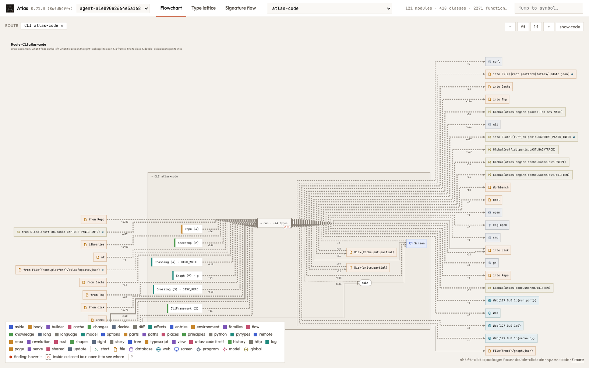

`atlas-code view .` draws Atlas's own route, `atlas-code.main`, closed in 1.8 s: the route the line
`Disk(repo) → Repo.read → … → File(html) → open` is read from. The tab that opened it crashed after 8 s, and the viewer's
model of it ran out of an 8 GB heap.

A step beyond the cut stands for the image of its body, made once for each function, call and set of callers. One part of
that image is, of each step, the values of each kind it takes from beyond or from its caller, which decide where two values
of one kind keep their names. A cut step carried that part up as a list from every step of its body unfolded to its leaves,
so a function its body reaches by many calls brought one group for each call: the call of `page::reading` alone carried
1 197 816 groups, of which 428 differ, and the 4907 arrows of the route 23.2 M. The groups are now a set, each held once.
Which kinds are split is a function of the groups there are, so no plan changes: the facts of all 417 other routes of
Atlas, the kinds they split and their closed pictures are the same before and after.

```text
the closed view of atlas-code.main in Chrome (tools/pictures.py draw, 1600 × 1000)
  0.71.0 (8cfd549f)   Page crashed after 8.0 s
  with #379           drawn in 1.83 s, 46 boxes, 162 MB JS heap once drawn
  (atlas-engine.language.Python, the largest route that drew before: 1.14 s, 1.13 s)

the viewer's model of atlas-code.main (plans.mjs, the facts of the finest plan), three runs
  0.71.0 (8cfd549f)   out of an 8 GB heap after 14.1, 16.9, 16.8 s (FINE_BUDGET 5000; at 500 after 17.8 s)
  with #379           2.30, 2.57, 2.76 s, 462 to 467 MB; 25 090 facts (at 500: 1.08 s, 393 MB)
  (atlas-engine.language.Python: 1.10 to 1.12 s, 364 to 370 MB; 1.07 to 1.14 s, 338 to 346 MB)

the 417 other routes of Atlas, in one process
  facts (527 174), split kinds, closed pictures at FINE_BUDGET 5000 and 3: identical
  0.71.0 (8cfd549f)   43.9 s, 3.6 GB    with #379   39.2 s, 1.6 GB

a route whose body, unfolded, has 2^40 occurrences (each of 40 levels called twice), at FINE_BUDGET 3
  0.71.0 (8cfd549f)   out of a 4.5 GB heap after 6.1 s
  with #379           0.09 s, 112 MB
```

The last program is the subject of the new test `a_step_beyond_the_cut_is_made_without_unfolding_its_body`
(`engine/tests/plans.rs`): a step beyond the cut is the image of its body made without unfolding it, so a body too large to
unfold is planned at every budget that cuts it, and its pictures are images of the plan.


