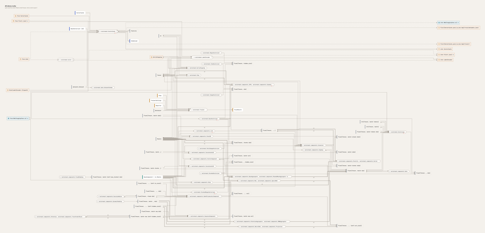
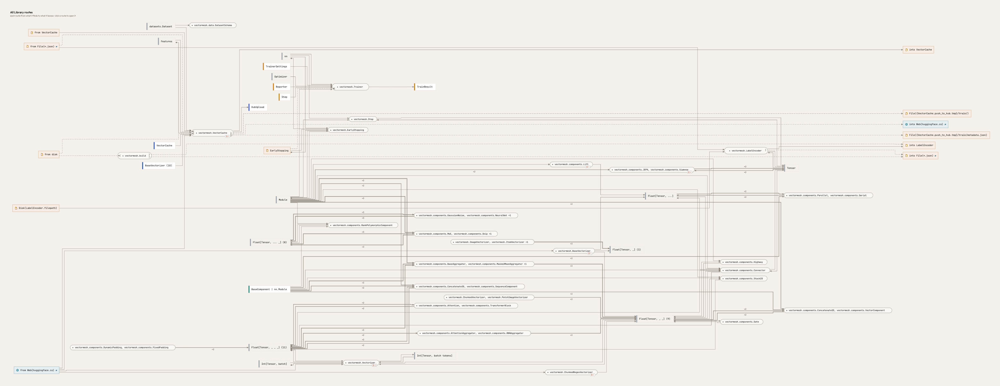
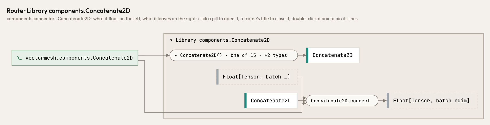
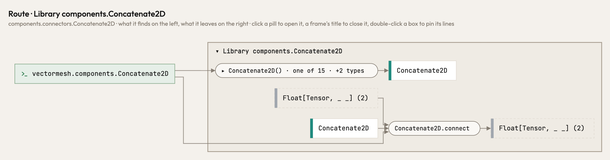
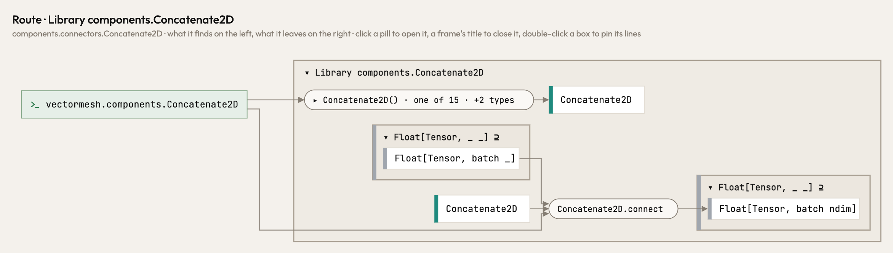

A program that annotates its tensors with jaxtyping (`Float[Tensor, "batch dim"]`) drew every shape as a place of its
own. `Float[Tensor, chunks dim]` and `Float[Tensor, batch ndim]` stood apart, so a model's components read as many
short, separate flows. Now each shape stands in its rank family, the way a subclass stands in its base class. Closed,
`Float[Tensor, _ _] (9)` stands for the rank-2 float tensors in the picture, `Float[Tensor, _ _ _]` for rank 3, and
`Float[Tensor, ... _]` for the shapes with a run of axes and one more (`... dim`, `batch ...`). A click opens the family into the
exact shapes. Names still matter: `batch dim` and `batch ndim` are two types of one family, since a named axis is one
size within a call. The dtype matters too: `Int[Tensor, batch tokens]` is rank 2 and stays apart from the float
tensors. A family is drawn only where the picture holds two shapes of its rank, and `Float[Tensor, ...]` (any rank)
stands as itself.

All library routes of vectormesh, before: each shape a box of its own.

After: four rank families, with `Float[Tensor, ...]` and the `Int` tensors beside them.

The route of `Concatenate2D`, which takes a `batch _` and gives a `batch ndim`. Before, then closed (both are rank 2),
then with the rank-2 family open, each value in its family's frame:

