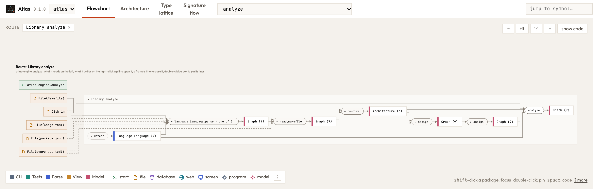

# Atlas — the guide

How to read the picture, what Atlas reads, and the commands. The [README](../../README.md) says
what Atlas is for; [principles.md](principles.md) what it asks of code; [design.md](design.md)
how it is built.

## Reading the picture

Here is Atlas looking at itself: the route `analyze`, which is what Atlas does when it
reads a repository.

<picture>
  <source media="(prefers-color-scheme: dark)" srcset="../img/flowchart-dark.png">
  
</picture>

Read it from left to right:

- **On the left** are the places whose content the route finds and uses: `from disk`, the
  repository's files, and the manifests `Cargo.toml` and `package.json`, by which it finds the
  repository's parts. The green `>_` box is where the route starts.
- **In the middle** are the steps. A rounded pill is a function. A box with a coloured
  bar is a value of a type in memory: `Options`, `Repo`, `Graph`. Arrows run in
  call order.
- **On the right** is what the route leaves: the places it writes, and those it reads only to
  check or count what it wrote there. A place one step writes and a later step reads stands
  between the two, inside the step that runs both, as the value between two arrows does. A
  place the route uses and also changes stands twice, `from X ⇄` on the left and `into X ⇄` on
  the right; ⇄ goes from the one to the other. A line marked `?` goes to a place the code does
  not say which way it uses (a query on a bare database session), which stands between the
  steps. Making a place's shape, a folder for a file or a table's schema, is part of what is
  written or read there. A database opened on a file (`duckdb.connect(path)`, `Connection::open(path)`)
  is that file's: the folder made for it is the database's, and no place of its own.
- **A dashed frame is a choice.** Its title says what decides each branch, as the code writes it,
  each in the branch's colour: `one of ● mode == "train" ● otherwise`. A step that runs only when
  a condition holds stands in a frame of its own, `only when not raw.exists()`: the route follows
  it in principle and skips it when the condition does not hold.
- **Read it as a sentence:** *read* the repository into a `Repo`, and make its `graph_of`
  with the `Options` of the reading. That is Atlas's whole job, and the code says it in two
  calls.
- **A solid line is what a step itself takes, a dashed line what a closed pill reaches
  inside.** `read` lists the files through `Repo.read`, and finds the project of a package
  named on its own; `graph_of` takes no file, but the readers inside it ask the `Repo` for a
  file's text, which is read from disk the first time it is asked for.
- **`Options (2)`, `Repo (2)` and `Graph (7)` are families**: a type and the types that belong to it or
  that it holds, folded into one box. Click one to open it. A config opens the same way
  into what it holds (`folders: Folders`). Inside `graph_of`, `parse · one of 3` is a
  choice: the same call goes to the Python, the Rust or the TypeScript reader.
- **A number `×n` on a line** is n lines of one channel between the same two boxes, drawn as one;
  opening a box splits it into the lines. **`+25 types` on a pill** counts the values that only that
  step takes and nothing else touches; opening the pill draws them, each on the step that takes it.
- **Click any pill** to open it into its own steps, and **show code** to see its source.
- **A step is a call.** A function the route calls twice is two steps, and a method called
  on a subclass's value is that subclass's (`ComparePlot.plot`). Values are drawn by the
  names the code holds them by (`Graph · g`, `DataFrame · data`), and a step that changes a
  value hands it on under the same name. A library operation Atlas does not read is a step in
  italics where the code names its result (`to_numpy`), or where it changes the container it is
  called on (`rows.append(row)` hands on `rows`). In a notebook, each call that makes
  a figure makes its own (`Figure 3 · ResidualPlot.plot`).
- **Files fold into their folders** once a picture holds more than a column's worth:
  `File(artefacts/) · 8` opens into what is in it with a click.
- **Shift-click a package** in the overview to focus on it: the picture keeps the packages
  in focus, the types that cross between them and the places they touch, and joins the
  rest of the code by counted arrows on either side. Click the rest to open it into the
  packages that hand the focus data or take data from it, and click one of those to add
  it to the focus. The state bar names the packages around the focus, the most exchanged
  first, to add with one click.
- **A vermilion dot in a corner is a finding** of `atlas check` (below) about that box, pill
  or route: hover the dot for what Atlas sees there and the question it asks. The dot sits
  inside its box, so findings move no box and no line. Atlas's own picture has none.
- **Double-click a box** to pin its lines, to study or compare what it connects.
- **Jump to symbol** opens what lies above the symbol and nothing beside it, and centres on
  it: in a route, the steps that call it; in the overview, its part and package. A symbol
  the route does not reach is shown in the first route that does. **close all ✕** at the
  end of the state bar closes everything opened and lets go of what is pinned, and keeps the
  route and the focus.
- **Space over a box** shows its details and code over the picture while the code panel is
  closed; space, Esc or a click on the picture puts them away, and **pin** keeps the panel
  open beside the picture.
- **Press `?`** in the page for every key and click on one card.

The same route as text, with its steps in call order, is the MCP tool `route` (see below).

## Use

```bash
atlas serve                     # the repository you are in, as a page to work in with your agent
atlas view                      # the same picture as one HTML file; opens in your browser
atlas view ../api ../web        # two repositories as parts of one picture
atlas view notebooks/explore.ipynb   # one file, with its project, opened on its route
atlas view https://github.com/o/r/tree/main/src/pkg   # one folder of a repository, from its URL
atlas check                     # where the code and the design principles disagree
atlas revelation                # the sketch code kept in the tree, and what is left to build
atlas changes                   # what your edits did to the routes, their places and the findings
atlas changes v1..main          # what one revision did against another
atlas history                   # the history in your browser: pick two commits, see them as one picture
atlas --help
```

`atlas serve` is the page to work in (see Serve, below). `atlas view` writes the same page as a
single HTML file and opens it, to keep, to send, or for a script or an agent to make. No server
runs and your code stays on your machine. The file goes to `.atlas/` at the top of the git repository (`--out` names
another place), where you and an agent working there both find it; the folder ignores itself,
so git never sees it. `atlas analyze` writes its `graph.json` there too. The page fetches only its drawing libraries (d3, elk, highlight.js) from a
CDN. It has three views. The **Flowchart** is the one to start with. Type lattice and
Signature flow are earlier experiments. The header names the build that drew
the page, as `atlas --version` does: `0.4.0 (b0ead14)`. The minor number goes up when what
Atlas reads or draws changes, the patch number for a fix.

Atlas reads:

- **Python**: the packages `pyproject.toml` names (Hatch's, setuptools' or Poetry's
  `packages`, else the project's name) and every other package beside them, and the
  project's scripts and notebooks at any depth (`.py` and `.ipynb` outside the packages,
  its tests and what git ignores; a project of only scripts and notebooks needs no package,
  and a file you name is read even where git ignores it), with
  its types from [ty](https://docs.astral.sh/ty/). The library modules its code calls are
  read from its environment too, so a library's own steps can be opened in a route;
  `--libraries 2` reads one step further into those libraries, `--libraries 0` not at all.
  Libraries with compiled code and the ones Atlas already knows (pandas, requests, torch, …)
  stay closed;
- **Rust**, including workspaces; the crates its code calls are read where Cargo keeps them (a
  path dependency, or the version `Cargo.lock` names in Cargo's registry sources), never fetched;
- **TypeScript and TSX**: React components, server routes (Hono, Express, Fastify), TanStack
  routes and server functions, `tsconfig` paths; the packages its code calls are read from
  `node_modules`, from what each package exports as code.

In every language a library is drawn as far as your code reaches it: the functions your calls
go into, each round of `--libraries` one call further, with the types they take and give.

A repository can hold several parts: a Python API and a TypeScript app, the crates of a
workspace, the members of a uv workspace. Atlas finds every `Cargo.toml`, `pyproject.toml`
and `package.json` itself, at any depth, and reads each part in its own language. The overview then shows each part as one step, from
what it reads to what it writes. Where one part names a route another part serves (the app
asks for `/api/items/{id}`, a FastAPI app mounted at `/api` serves `/items/{id}`), the two
meet in that part's `HTTP`. Click a part to open it; **Only *part*** in the menu keeps to
one.

A part opens into its packages, each as one step from what its own code reads to what it
writes. Between packages stand the types that cross them: data one package makes and
another takes. A sink or a repository is not drawn as a type there: it is a door to its
database, and the database is drawn. A dotted line joins a package to one it calls.
A package opens into its subpackages, and a module into its routes and the functions other
packages call in it. This overview stands even when Atlas finds no entry points.

Atlas reads Python's types through ty, Astral's type checker, with the project's own
environment: the one `[tool.ty.environment]` in `pyproject.toml` names, else the project's
`.venv`. A venv that is active in your shell is not the project's and is not read. Where ty does not know a type, Atlas does not guess, so the picture is as
precise as the code's annotations. It sees best when:

- the environment is synced (`uv sync`), so that libraries have types. Without one, Atlas
  still knows a call to `requests.get`, but not what the value it gives back is;
- every parameter and every return is annotated. Ruff's `ANN` rules ask for both:

  ```toml
  [tool.ruff.lint]
  extend-select = ["ANN"]
  ```

- a variable is annotated where its value says nothing: an empty container
  (`nodes: list[Node] = []`) or `None` to begin with (`self.conn: Connection | None = None`).
  ty infers the rest.

Rust says most of this itself, since every signature is typed. Atlas follows a value through
`if let`, `let .. else`, a `match` arm and `Ok(..)` or `Some(..)`; a method called on what a call
gives (`Trend::new(settings).save(..)`) is a step on that type; a field of clap's derived options
holds the `default_value` its attribute declares; and a name a module takes from a single library
glob (`use plotters::prelude::*`) is that library's. In TypeScript, what `parseArgs` gives for an
option holds its `default:`, and an object literal declared as one of the program's types
(`const settings: Settings = {..}`) is a step that makes that value.

`atlas check` asks for a return annotation where callers use what a function gives back.

Entry points come from the code itself. Atlas finds:

- the programs and plugins a `pyproject.toml` declares (`[project.scripts]`,
  `[project.gui-scripts]`, `[project.entry-points]`, `[tool.poetry.scripts]`), `package.json`
  `bin` and scripts that run a file of the package, and a Rust binary's `main`;
- commands (`@app.command` from click or typer, by the name that framework gives it);
- web routes (`@app.get("/…")` and `@app.route("/…", methods=[…])` from FastAPI or Flask,
  Litestar's `@get("/…")`, `app.get("/…", handler)` as in Hono and Express, each at the full
  path of the routers it is mounted on, and TanStack file routes);
- MCP tools, Makefile targets, scripts, notebooks and tests;
- what a library exports: at its root (in TypeScript the module `package.json` points to), and
  in Rust also through `pub mod` and `pub use`.

A command or script shows what you hand it on the command line, as its usage line:
`$ sunspots --raw --figure --months`, from typer's parameters, click's decorators, clap's fields,
the keys of `parseArgs`' options or argparse's `add_argument`. The step that parses the command
line (`Cli::parse()`, `parseArgs(..)`, `parser.parse_args()`) belongs to that entry: the route's
steps take what it gives straight from the entry, and clicking the entry shows the parse.

## Check: the picture as a list of questions

`atlas check` reads the same graph and lists where the code and eleven design principles
disagree. Each finding ends in a question for the author. Atlas coaches; it does not fix.
The questions are grouped by principle, and the reason they share is said once, above them.
Below them a table counts the questions of each principle in each part. `--json` gives the
findings as data.

| Principle | In one line |
| --- | --- |
| `doors` | A package names its doors, and each door says what goes in and what comes out. |
| `sums` | A sum type is unwrapped where it arises. |
| `overrides` | An override keeps the promise of its base. |
| `places` | Library code does not decide where data lives. |
| `changes` | A change to an input shows in the signature. |
| `gives` | A function whose value is used says what it gives back. |
| `choices` | A choice is made once, in a place with a name. |
| `nothing` | A call leaves something behind. |
| `layers` | The packages of a part depend on one another in one direction. |
| `lens` | What a lens puts, it gets back. |
| `prophecy` | Code that is built does not lean on code that is not. |

Each principle, with its reasoning, the idioms behind it and what each language lets Atlas
trace, is in [principles.md](principles.md). Atlas holds itself to them: `atlas check` on
this repository finds nothing, and the tests keep it that way.

## Revelation: what a design leaves to build

A design can live in the tree as sketch code, marked as not built yet: a *prophecy*. Python marks
it with a decorator, `@prophecy(supersedes="pkg.Old")` (a no-op function in the project; Atlas
matches it by name), Rust with `#[doc = "prophecy: supersedes=pkg::Old"]`, TypeScript with a
`@prophecy supersedes=pkg.Old` tag in the JSDoc before a `declare` function, class, interface or
type. `veiled` says the place is known and the shape is not, `sealed="#144"` that the shape waits
on an open question.

A prophecy is a todo, not a finding: `atlas check` leaves its empty bodies alone, and asks about
the built code that leans on it, because production would run on a stub. What a prophecy
supersedes is still asked about, with the prophecy as the answer.

`atlas revelation` lists every prophecy: what it supersedes, the bodies still to write, whether it
is veiled or sealed, and the built code that leans on it. The sketch is done when the list is
empty; a prophecy is fulfilled when its marker is gone. The page draws a prophecy in its own
colour with a dotted border (finer when it is veiled), as a route of its own for each operation of it, and its
inspector says what it supersedes and what supersedes a box. Agents ask the same with the MCP
tool `revelation`.

A prophecy whose shape waits on an open question is *sealed* on its issue (`sealed="#144"`, or
`owner/repo#144`). `atlas revelation --seals` (the MCP tool `seals`) lists the seals, each with
what `gh` says of its issue: open, closed (then the seal can be broken) or unknown, where there is
no `gh`, no network or no such issue. The MCP tool `unseal` breaks them: it takes `sealed=..` out of
the marker of the prophecies named, or of every one whose issue is closed, and changes nothing
else. The files are left for you to commit; sketch the shape next.

A vision that is decided becomes a prophecy with the MCP tool `prophetize`: the vision's files are
written into the tree, every item the vision adds marked in the language of its file (and, for
Python, the project's `prophecy` imported, and the bodies that ty would refuse made `raise NotImplementedError`), and the vision is retracted. `supersedes` says which
existing item an added one replaces. The files are left for you to commit; Atlas opens no branch.
A vision that changes or removes what exists is refused, since writing it would replace built code
with a sketch: the new item takes a new name and supersedes the old one.

## Changes: what an edit did

`atlas changes [<rev>]` reads the working tree against a git revision (`HEAD` by default)
and lists what the edit did: the routes added and removed, the steps and places each route
gains and loses, the ordered compositions that differ, and the findings it raises and resolves.
Changing call order or repeating a call changes a composition even when the route reaches the
same functions. JSON records each such function with its `before` and `after` bodies under
`compositions_changed`; each body retains its choices and dispatch. `atlas changes A..B` compares two
revisions the same way (a side left out is `HEAD`, as in git). In a design loop, that is the
question after every step: does the change do what it was meant to, and nothing else? A
revision is read from git into a directory of its own; the working tree and the index stay
as they are.

```text
since HEAD

~ API · POST /api/regels
    - step server.regels.vat
    - place asks an LLM create
```

`atlas view --since <rev>` draws the revision and the working tree as one picture
(`--until <rev>` draws two revisions): what both hold, drawn once, with what changed marked as a
diff marks lines.

- **Added** in B: a green border and `+`.
- **Removed** in B: a red dashed border, the name struck through, `−`.
- **Changed**: an amber border and `~`; the tooltip says what it was. A function is changed when
  its own arrow differs (what it takes and gives, what its own calls read and write, its usage
  line); a place or a value when the arrows into or out of it differ. A step a body gains or loses
  is marked itself, and a change marks only the step that changed, never what runs before or after
  it. A function renamed with the same relations is one function, changed, and reads `old → new`.

The same marks go on the lines. The header names A and B, counts what was added, removed and
changed, and switches between **A**, **A ∪ B** and **B**: a switch hides boxes and never moves
one. The route list marks a route `+`, `−` or `~`.

## History: two commits as one picture

`atlas history [repo]` serves the repository's history on this machine and opens it in the
browser: the commits of every branch and tag, and beside them the picture of the one you pick, or
of two you pick as one picture, marked as above. The working tree is the newest row. It answers
at `127.0.0.1` only (`--port N` picks the port, `--no-open` leaves the browser closed), reads each
commit once and keeps it from one run to the next, and reads the working tree again on every
request, so an edit shows when you pick it again.

## Serve: one view, shared with your agent

[The tour](https://raoulg.github.io/atlas/#point) shows what follows, drawn from one real run.

`atlas serve [repo]` serves the picture of the working tree on this machine (`127.0.0.1`,
`--port N`, `--no-open`), and shares it with the agent you work with through `atlas mcp`. Its
terminal says that it runs and where, then a line for each thing worth knowing: the files that
changed, the picture drawn, an export, a note, and what the agent did with it.

- **The code as it is now.** The server looks at the files Atlas reads every second. When one
  changes, it draws the picture anew, and the page reloads to it in the view you had: the route,
  what you opened, the box you selected, the pinned ones and the zoom. While you write a note or
  a symbol to jump to, the page waits and the header says **the code changed ↻**. While nothing
  changes the picture is kept, so a reload is at once.

- **What you have open.** The page tells the server its view, the box you selected, and the
  boxes and lines it draws. The agent reads them with `shown` when you say "this box".
- **Look here.** The agent points the page at a view, a box or a line with `look`. The page goes
  there, opens the way to the box, selects it and makes it light up.
- **What the agent says.** With `annotate` the agent puts its own words on a box or a line: what a
  condition means ("only on the first run"), what a step is for. A ✦ marks it; hover it for the
  words. They are the agent's statements, apart from what Atlas traces.
- **A vision.** To ask "shall I do this?", the agent shows the change rather than describing it.
  With `vision` it gives the files the change would write, as sketch code: the signatures with
  their types and the calls in their order, bodies left empty. A sketch has to parse, not to
  build: Atlas reads it as it reads the code. The page draws the working tree (A) and the
  vision (B) as one picture, as the history draws two commits: what the vision adds, removes
  and changes is marked, and **A**, **A ∪ B** and **B** switch between them. A route that only
  one side has is drawn whole, and only what the code adds or removes in it is marked: the steps
  and types it reuses stay as they are. Point at what you
  think of it with a note. The working tree stays as it is; once the vision is decided, the
  agent retracts it.
- **Notes.** Alt-click a box or a line to write a note on it ("I do not understand this line").
  The ring on it is open until the agent reads it, dimmed once it has, and a ✓ once it resolves
  it. The agent resolves a note where it works with you, by a fix or by explaining; Atlas is no
  chat, and reading a note does not resolve it. Hover the ring for the notes, and for the commit
  that fixed one, if one did. Alt-click a box with a resolved note to open it again with what is
  still unclear. A note is for the work at hand: a resolved note stays on the picture while this
  `atlas serve` runs, and the next one starts without it. What must last, the agent puts in an
  issue, with a link to the note's place that opens it in `atlas serve` (each repository is
  served at a port of its own, the same each time). Esc, the field's ✕ or a click beside it
  drops a note before it is kept.
- **History.** **history** opens the commits beside the page, as `atlas history` does, from the
  same process. Pick a commit to see it beside the working tree, or two to see as one; **✕ close
  history** goes back to the page.
- **Export.** **export** keeps the picture as one HTML file, opened in the view you have: the
  file `atlas view` writes.

What the page and the agent share is kept in `.atlas/` (`shown.json`, `look.json`,
`notes.json`, `serving.json`, `vision.json`, `annotations.json`), so the two need not run
together, and git never sees it.

## What Atlas keeps

What does not change is kept between readings, in `$XDG_CACHE_HOME/atlas` (else
`~/Library/Caches/atlas` on macOS, `%LOCALAPPDATA%\atlas` on Windows, `~/.cache/atlas`), a
directory per build of Atlas:

- what ty says of a file of an installed Python library, by the file's bytes and the environment
  it is read in: the distributions installed, the `.pth` files, the Python ty reads with, and the
  names the project's own modules take before a library's;
- the parts of a commit, for `atlas changes`, `atlas view --since` and `atlas history`, while what
  the reading took from outside the commit (a crate by its path, a fetched crate, the environment
  beside the repository) stands as it did.

The working tree is read anew every time, and so are the crates and packages it reads: their code
is linked together with yours. What is kept is what a reading anew gives, so the picture is the
same either way. `--no-cache` reads everything anew and keeps nothing.

## Give your coding agent the same picture

`atlas mcp` serves Atlas over the [Model Context Protocol](https://modelcontextprotocol.io).
The tools are `principles`, `check`, `explain`, `routes`, `route`, `choices` and `changes`;
`route` returns what one entry point does, step by step, `choices` the choices it makes with what
decides each branch, and `changes` what the working tree did
since a commit (or, with `until`, what one commit did against another), so an agent can check its
edit against what it was meant to do. Register it once, for every project, in
[Claude Code](https://claude.com/claude-code) and in [Codex](https://openai.com/codex):

```bash
claude mcp add --scope user atlas -- atlas mcp
codex mcp add atlas -- "$(command -v atlas)" mcp
```

Claude Code's `--scope user` makes it available in every project. Codex keeps its servers in one
configuration for all projects and starts them without your shell's `PATH`, so it is given the
binary's full path, which `command -v atlas` prints. The server works on the repository the agent
runs in, so `atlas serve` in any repository is all it takes. Any other MCP client takes the same
command: `{"command": "atlas", "args": ["mcp"]}`, with the full path where the client does not
pass on your `PATH`.

## Keep the picture in your README current

A GitHub workflow can draw the page and its picture on every push and publish them on GitHub Pages,
so the README always shows the code as it is; a commit hook does the same before every commit. The
workflow needs nothing installed on your own machine. [The how-to](ci.md) has the workflow, the hook
and the script that takes the picture.
